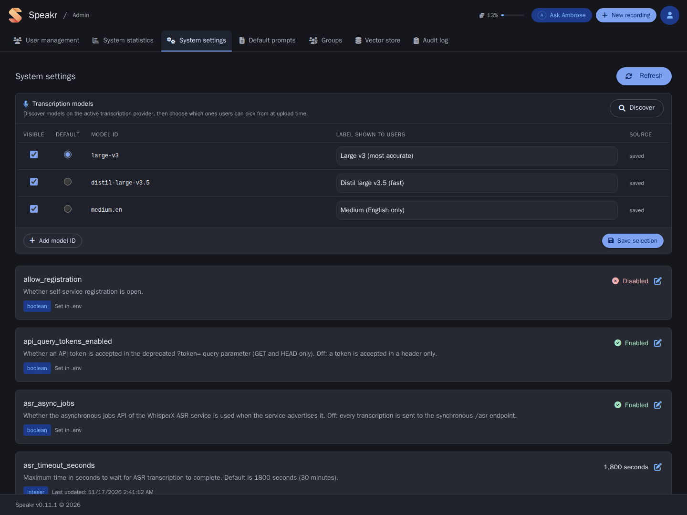

# System Settings

System Settings is where you configure the fundamental behaviors that affect every user and recording in your Speakr instance. These global parameters shape how the system operates, from technical limits to user-facing features.



## Transcript Length Limit

The transcript length limit determines how much text gets sent to the AI when generating summaries or responding to chats. This seemingly simple number has a big effect on both quality and cost.

When set to "No Limit," the entire transcript goes to the AI regardless of length. This ensures the AI has complete context but can become expensive for long recordings. A two-hour meeting might generate 20,000 words of transcript, consuming significant API tokens and potentially overwhelming the AI model's context window. This limit will also be applied to the speaker auto-detection feature in the speaker identification modal.

Setting a character limit (like 50,000 characters) creates a ceiling on API consumption. The system will truncate very long transcripts, sending only the beginning portion to the AI. This keeps costs predictable but might mean the AI misses important content from later in the recording.

The sweet spot depends on your use case. For typical meetings under an hour, 50,000 characters usually captures everything. For longer sessions, you might increase this limit or train users to split recordings. Monitor your API costs and user feedback to find the right balance.

## Default Storage Quota

**`default_storage_quota_mb`** (default 0, no limit) is the storage quota given to accounts created after it is set, by an administrator, by registration or by SSO. The quota of an existing account does not change; it is set per user in Edit User. See [Storage Quotas](user-management.md#storage-quotas).

## Maximum File Size

Two separate caps apply depending on file type:

- **`max_file_size_mb`** (default 300 MB) — applies to audio uploads. Protects storage from runaway audio.
- **`max_audio_only_video_size_mb`** (default 4 × `max_file_size_mb`, ≈ 1200 MB) — applies to **any** video file regardless of whether the video stream will be kept. Video files are typically much larger than the audio they contain, so they get their own (larger) ceiling.

When chunking is enabled (`ENABLE_CHUNKING=true`, the default), the upload route lets files through above these caps and chunks them on the server for the ASR call. An upload larger than the higher of the two caps is refused in either case. When chunking is off, the caps are enforced strictly. Files whose **extracted audio** still exceeds `max_file_size_mb` are rejected with a clear error when chunking is off; with chunking on, the chunking pipeline handles them.

The "Keep audio only" toggle on the upload form determines whether the video stream is retained — it no longer affects the size cap (that's controlled by file type). Use it when you specifically don't want the video kept on disk.

Raising these limits allows longer recordings but requires careful consideration. Larger files take longer to upload, consume more storage, and might timeout during processing. Your server needs enough memory to handle these files, and your storage must accommodate them. Network timeouts, browser limitations, and user patience all factor into what's practical.

If users frequently hit the limit, consider whether they really need single recordings that long. Often, splitting long sessions into logical segments produces better results - easier to review, faster to process, and more focused summaries.

## ASR Timeout Settings

The ASR timeout determines how long Speakr will wait for advanced transcription services to complete their work. The default 1,800 seconds (30 minutes) handles most recordings, but you might need to adjust based on your transcription service and typical file sizes.

Setting this too low causes longer recordings to fail even when the transcription service is working normally. The recording appears stuck in processing, then eventually fails, frustrating users who must retry or give up. Setting it too high ties up system resources waiting for services that might have actually failed.

Your optimal timeout depends on your transcription service's performance and your users' recording lengths. Monitor processing times for successful transcriptions and set the timeout comfortably above your longest normal processing time. If you regularly process multi-hour recordings, you might need 3,600 seconds or more.

## Asynchronous WhisperX Jobs

The `asr_async_jobs` setting (`ASR_ASYNC_JOBS` in `.env`, default `true`) determines whether the asynchronous jobs API of the [WhisperX ASR service](whisperx-setup.md), version 0.5.0 and later, is used. With the setting on, the `capabilities` object of the service's `/health` answer is read before each transcription. When the jobs API is advertised, the audio is submitted as a job, the job is polled at the interval the service suggests, and the result is fetched and then deleted from the service. The synchronous `/asr` request is used for services without the jobs API, and for every service while the setting is off.

With the jobs API in use:

- The remote job id is saved on the processing job. A retry after a failed attempt or a restart of Speakr polls the same job. The audio is submitted again only when the service no longer knows the job or its result has expired.
- Each submit has an `Idempotency-Key` header built from the recording, the processing job, the audio and the transcription parameters, so a repeated submit is attached to the job already running.
- After a busy answer (503, or 413 with `Retry-After`), the submit is repeated once the `Retry-After` time has passed, within the ASR timeout.
- A transcription that has no processing job to save the job id on cannot be resumed: a chunk of a chunked transcription, incognito mode and the voice check. Its job is deleted from the service when the attempt fails, and its `Idempotency-Key` is built from the recording or the user, the chunk number and the audio.

To find out which path a transcription took, see [WhisperX Asynchronous Jobs](../troubleshooting.md#whisperx-asynchronous-jobs). The technical details are in [Job Queue System](../advanced/job-queue-system.md#5-asynchronous-jobs-of-the-whisperx-asr-service).
- After a job error marked as not retryable, such as `audio_too_long` or `file_too_large`, the recording is marked failed without a retry. Other job errors are retried up to `JOB_MAX_RETRIES`.
- The ASR timeout applies to each attempt. A job still running at the timeout is kept on the service, and the next attempt resumes it.
- When a recording or its processing job is deleted, the remote job is cancelled on the service.
- A remote job that has ended for good is deleted from the service: a job reported as failed, cancelled or interrupted, and a job still saved when the processing job fails without a retry left. A job kept for the next attempt is not deleted. If the service cannot be reached, the job id stays saved and the deletion is tried again when the processing job is retried, deleted or cleaned up.
- The stage reported by the service is part of the job queue status. A progress fraction is stored on the processing job, as `progress_done` out of a `progress_total` of 100, only when the service does not mark it as estimated (`fraction_estimated`). An estimated fraction is written to the log and is not shown. See [Progress and Stage](../advanced/job-queue-system.md#6-progress-and-stage).
- When a running transcription is canceled in the processing queue, the remote job is deleted from the service.

## Login Lock

Wrong passwords on the sign-in page are counted for each account and client address. After `login_max_failed_attempts` wrong passwords (default `5`) from one address for one account, password sign-in for that account from that address is refused for `login_lockout_minutes` (default `15`), even with the correct password. Sign-ins from other addresses are not affected: the owner can still sign in from elsewhere, and an account cannot be locked for everyone by repeated guesses from one address. To turn the lock off, set `login_max_failed_attempts` to `0`.

For a locked account, the same message is shown as for a wrong password. The count is reset by a correct password before the limit is reached. In User Management, a locked account has a lock icon beside its username, and every lock on the account is ended with **Unlock login** in the Edit User dialog. The lock also ends when a new password is set by an administrator or through a password-reset email. SSO sign-in is not affected.

Behind a reverse proxy, the client address is read from the proxy's `X-Forwarded-For` header, as for the per-address limit below. Set `TRUSTED_PROXIES` as described in [Reverse-proxy hops](../getting-started/installation.md#reverse-proxy-hops) so that a client connecting to Speakr directly cannot choose its own address. Without a reverse proxy, set `TRUSTED_PROXY_HOPS=0`. IPv6 addresses are counted by their /64 network. Separately, 10 sign-in attempts per minute are allowed from one address.

## Default Timezone

Dates in generated titles (naming-template dates and default titles), in exported files and in the dates given to the AI are written in each user's timezone. A user's timezone is reported by their browser or chosen in Account → Preferences. The default timezone is used for users without one, for example accounts that only use the API or the watch folder. It is set in the [User defaults](#user-defaults) panel. On a new installation it is UTC; if the `TIMEZONE` variable from earlier versions is set, its value is used as the initial default. Stored dates and API responses are always UTC.

## Recording Disclaimer

The recording disclaimer appears before users start any recording session, making it perfect for legal notices, policy reminders, or usage guidelines. This markdown-formatted message ensures users understand their responsibilities before creating content.

Organizations often use this for compliance requirements - reminding users about consent requirements, data handling policies, or appropriate use guidelines. Educational institutions might note that recordings are for academic purposes only. Healthcare organizations could reference HIPAA compliance requirements.

!!! info "Full Markdown Support (v0.6.2+)"
    The recording disclaimer now supports **full markdown formatting**, including:

    - **Headings** - Structure your disclaimer with `# Main Title` and `## Sections`
    - **Lists** - Bulleted and numbered lists for clear requirements
    - **Bold and Italic** - Emphasize important terms with `**bold**` or `*italic*`
    - **Links** - Reference detailed policies with `[Privacy Policy](https://yoursite.com/privacy)`
    - **Code blocks** - Include examples or technical requirements
    - **Blockquotes** - Highlight key legal notices

    Example markdown disclaimer:
    ```markdown
    ## Recording Consent Required

    By starting this recording, you agree to:

    1. Obtain consent from all participants
    2. Comply with [company privacy policy](https://example.com/privacy)
    3. Handle recordings according to **GDPR** requirements

    > **Important**: Recordings containing sensitive information must be deleted within 30 days.
    ```

Keep disclaimers concise and relevant. Users see this message frequently, so lengthy legal text becomes an ignored click-through. Focus on the most important points, and link to detailed policies if needed. The markdown support lets you format the message clearly for better readability and comprehension.

## Upload Disclaimer

The upload disclaimer works just like the recording disclaimer, but it appears when users upload files rather than when they start recording. Every time a user drags and drops files or selects files for upload, they'll see this notice and must accept it before the files are queued for processing.

This is useful when uploaded files may contain third-party content or when your organization needs to remind users about data handling before they submit files to the system. The disclaimer supports full markdown formatting, just like the recording disclaimer.

!!! example "Example upload disclaimer"
    ```markdown
    ## Upload Policy

    By uploading files, you confirm that:

    - You have the right to share this content
    - No sensitive personal data is included without authorization
    - Files will be processed by external transcription services

    > See our [data handling policy](https://example.com/policy) for details.
    ```

Leave this field empty to disable the upload disclaimer entirely. When empty, file uploads proceed immediately without any prompt.

## Custom Banner

The custom banner displays a persistent message across the top of the main content area for all users. It's useful for announcements, maintenance notices, compliance reminders, or any message you want everyone to see when they use Speakr.

The banner appears below the header and above the main content. Users can dismiss it by clicking the X button, but it reappears on page refresh, ensuring the message stays visible as long as you have it configured.

Like the disclaimers, the banner supports full markdown formatting, so you can include bold text, links, and other formatting. Keep banner text short and to the point since it takes up screen space.

!!! example "Example banners"
    ```markdown
    **System update** — Speakr will be briefly unavailable on Sunday 10pm-12am for maintenance.
    ```

    ```markdown
    All recordings are subject to our [acceptable use policy](https://example.com/aup). Contact IT with questions.
    ```

Leave this field empty to hide the banner completely.

## User defaults

The **User defaults** panel lists the settings that every new account starts with. Each one has the control of the Account page. Users can change these settings afterwards.

| Default | Setting | Values | Built-in value |
|---|---|---|---|
| Interface theme | `default_ui_theme` | `default`, `classic`, `workspace`, `focus`, `desk`, `cards` | `cards` |
| Color scheme | `default_color_scheme` | `blue`, `emerald`, `purple`, `rose`, `amber`, `teal` | `emerald` |
| Player position | `default_audio_player_position` | `top`, `bottom` | `top` |
| Interface language | `default_ui_language` | a shipped language, such as `en` or `de` | `en` |
| Transcription language | `default_transcription_language` | `auto` or a language code | `auto` |
| Language for summaries, chat and translations | `default_output_language` | `auto` or an English language name, such as `German` | `auto` |
| Timezone | `default_timezone_mode` | `auto` (the zone of the user's browser), `fixed` (the default timezone) | `auto` |
| Default timezone | `default_timezone` | an IANA zone | `UTC` |
| Automatic summaries | `default_auto_summarization` | on, off | on |
| Automatic speaker labelling | `default_auto_speaker_labelling` | on, off | off |
| Event extraction | `default_extract_events` | on, off | off |

The defaults are written on an account when it is created: by registration, by an administrator, by a first SSO sign-in and by the admin account from `.env`.

**Existing accounts.** When you change a default and some accounts still have the previous default, their number is shown and you are asked whether to apply the change to them. With **Apply to N accounts**, only those accounts are updated. An account with any other value was changed by its user and stays as it is. The same holds for an account whose user changed the setting and later went back to the default value; such changes are recorded from this version on. With **New accounts only**, the default is saved and no account changes. With **Cancel**, the default stays as it was. Without such accounts, the default is saved without a question.

An account from before a setting existed has no stored value. It counts as having the previous default only when the missing value means that default: the standard theme, the blue color scheme, the player at the bottom, English, automatic language detection, the automatic timezone, summaries on, speaker labelling off and event extraction off.

**Timezone.** With `fixed`, new accounts get the default timezone as a fixed zone. With `auto`, the zone of each user's browser is saved as the user visits, and the default timezone is used only for accounts without a zone (see [Default Timezone](#default-timezone)).

**Automatic summaries** has no effect while `disable_auto_summarization` is on. **Automatic speaker labelling** needs a transcription service with voice profiles or contextual labelling.

Each change is recorded in the [audit log](audit-log.md) with the old and the new default and the number of accounts updated.

**API.** With `POST /admin/settings`, a default is saved as before and no existing account changes. With `"apply_to_existing": true` in the body, the accounts on the previous default are updated in the same request, and the response has `users_updated`. `GET /admin/user-defaults/<setting>/accounts` returns the number of accounts on the current default.

## Default look for new accounts

The **Interface theme** and **Color scheme** defaults (`default_ui_theme`, `default_color_scheme`) are set in the [User defaults](#user-defaults) panel. Without a saved value, new accounts start with the **Cards** theme and the **Forest Emerald** color scheme.

| Setting | Values | Default |
|---|---|---|
| `default_ui_theme` | `default`, `classic`, `workspace`, `focus`, `desk`, `cards` | `cards` |
| `default_color_scheme` | `blue`, `emerald`, `purple`, `rose`, `amber`, `teal` | `emerald` |

`default` is the standard theme, and `emerald` is the color scheme shown as Forest Emerald. A value outside the list is refused on this page. In `.env`, a value outside the list is replaced by `default` or `blue`, and a warning is written to the log.

Existing accounts keep their theme and color scheme unless you apply a changed default to them. Users who never picked a theme keep the standard theme with the blue color scheme, or the look they picked in a browser before themes were saved with the account. Users change both in Account settings.

On the sign-in, registration and password reset pages, and on recordings shared with a public link, the same defaults are shown in a browser with no theme or color scheme saved. In a browser where a theme or color scheme was picked before, that choice stays. After sign-in, the account's own theme and color scheme apply, and the defaults for new accounts are not used.

## Audio player position for new accounts

With the **Player position** default (`default_audio_player_position`) in the [User defaults](#user-defaults) panel, you choose where the audio player sits on a recording's page for every account created afterwards. The value is `top` (under the title) or `bottom` (under the transcript and summary). Without a saved value, new accounts get `top`.

A value outside the list is refused on this page. In `.env`, a value outside the list is replaced by `bottom`, and a warning is written to the log.

Existing accounts keep their position unless you apply a changed default to them. Users who never picked a position keep the player at the bottom. Users change it under **Account → Preferences → Player position**.

## Who Can Create Groups

The **permission_create_groups** setting decides who can create groups: `admins` (site admins only, the default), `selected` (site admins, users with **Can create groups** and members of groups with **Members can create groups**) or `everyone`. Any other value is refused on this page. A user who is not a site admin and creates a group becomes its group admin. See [Who Can Create Groups](group-management.md#who-can-create-groups).

## Who Users Can Find

The **user_search_scope** setting (`USER_SEARCH_SCOPE` in `.env`) decides who a user can find in the share window by typing part of a username:

| Value | Shown as | Part of a username finds |
|---|---|---|
| `everyone` | Everyone | Any account |
| `groups` | People in their groups | Only accounts that share a group with the user |
| `exact` | Exact username or email | Nobody |

At every level, the full username or the full email address finds its account, at least two characters are needed, and at most ten accounts are listed. An email address is matched only when it is typed in full, without regard to case, so no search tells whether part of an address exists. The results show usernames only; a site admin also gets the email address. Any other value is refused on this page.

The level also applies to the share request itself, so the search cannot be bypassed with a user id. A recording is shared with an account only when the person sharing could find that account in the search: at `everyone` any account, at `groups` an account in one of their groups, and at every level an account named by its full username or full email address. A request that names an account by its numeric id alone is refused at `exact`, and at `groups` for an account outside the person's groups, with the same answer as for an account that does not exist. Site admins are not restricted.

A script that calls `POST /api/recordings/<id>/share-internal` with `user_id` or `user_ids` needs `identifier` or `identifiers` as well at these two levels: the full username or the full email address of each person. Either field can also be sent without the ids.

Without a saved value and without `USER_SEARCH_SCOPE`, the level follows `show_usernames_in_ui`: `everyone` when usernames are shown, `exact` when they are hidden. A group admin who is not a site admin adds members by full username or full email address at every level. The user search of the admin pages is not affected.

## Privacy and Security Settings

The settings in this section were added for deployments with regulated data. The data concerned is described in [Privacy and regulated data](privacy.md). Each setting can also be set in `.env`, as listed under [Settings That Fall Back to .env](#settings-that-fall-back-to-env).

| Setting | Variable in `.env` | Default | Effect |
|---|---|---|---|
| `session_idle_timeout_minutes` | `SESSION_IDLE_TIMEOUT_MINUTES` | `0` | Minutes without a request after which the user of a browser session must sign in again. `0`: no idle timeout. |
| `api_query_tokens_enabled` | `API_QUERY_TOKENS_ENABLED` | `false` | `false`: an API token in the `?token=` query parameter is refused on every method. `true`: it is accepted on `GET` and `HEAD` requests. |
| `webhook_delivery_retention_days` | `WEBHOOK_DELIVERY_RETENTION_DAYS` | `30` | Days after which a webhook delivery record is removed. `0`: the records are kept without limit. |
| `webhook_omit_titles` | `WEBHOOK_OMIT_TITLES` | `false` | `true`: the recording title and the original file name are left out of webhook payloads. |
| `auto_export_delete_with_recording` | `AUTO_EXPORT_DELETE_WITH_RECORDING` | `false` | `true`: the automatically exported file is deleted together with its recording. |
| `incognito_temp_max_age_hours` | `INCOGNITO_TEMP_MAX_AGE_HOURS` | `6` | Hours after the last write at which a leftover temporary file of an incognito request is removed. |
| `audit_log_enabled` | `AUDIT_LOG_ENABLED` | `true` | `false`: no event is recorded in the audit log, except changes of the audit log settings and the reading, export and pruning of the log. |
| `audit_log_retention_days` | `AUDIT_LOG_RETENTION_DAYS` | `365` | Days after which a row of the audit log is removed. `0`: the rows are kept without limit. |
| `audit_log_store_ip` | `AUDIT_LOG_STORE_IP` | `full` | `full`, `truncated` (the `/24` network of an IPv4 address, the `/48` network of an IPv6 address) or `off`. |
| `audit_log_record_views` | `AUDIT_LOG_RECORD_VIEWS` | `true` | `false`: opening and playing a recording is not recorded. Downloads, exports, reads through API v1 and public link events are still recorded. |

### Audit log

Sign-ins, access to recordings, changes, shares and administrative actions are recorded in the audit log, which is on by default. The four `audit_log_*` settings above determine whether events are recorded, for how long the rows are kept, and whether the client address is stored. A change of one of these settings is itself recorded, also while the log is off. The events, the Audit log tab and the export are described in [Audit log](audit-log.md).

The setting `audit_log_notice_dismissed` holds whether the notice on the Audit log tab was dismissed. It has no other effect.

### Session idle timeout

With `session_idle_timeout_minutes` above `0`, the time of the last request is kept in the signed session cookie. A browser session without a request for longer than the value is ended at the next request: an API request is answered with `401`, and a page request is redirected to the sign-in page. The following rules apply:

- API tokens are not affected.
- The requests sent in the background of an open page (the notification count, the job queue status and the refresh of the CSRF token) are not counted as activity. A tab left open is therefore signed out as well.
- The "Remember me" cookie is not accepted while a timeout is set, and it is removed at the next request.
- No request is sent during a recording that is held in the browser (an incognito recording, or any recording with server-side chunks turned off). The value must be longer than the longest expected recording. Otherwise the upload at the end is answered with `401`, and an incognito recording, which is held in the memory of that tab only, is lost when the user signs in again in the same tab.

### Tokens in the query parameter

The `?token=` query parameter is deprecated, because a URL with a token is recorded in proxy logs and in the browser history. It is off by default, also on an installation upgraded from v0.11.4 or earlier, unless a value was saved for `api_query_tokens_enabled` on this page. A request that carries its token only in the query parameter is answered with `401` and the code `query_token_disabled`, on every method. Tokens in the `Authorization: Bearer`, `X-API-Token` and `API-Token` headers are accepted as before.

With `api_query_tokens_enabled` set to `true`, the parameter is accepted on `GET` and `HEAD` requests with a full-access token, and each response has the header `Deprecation: true`. The setting is meant for the time needed to change older clients.

Requests that cannot carry a header are affected as follows:

- The web interface is not affected. Its audio and video players are authenticated by the session cookie.
- Public links are not affected. The page and the audio of a public link are addressed by the id of the link.
- The ASR Voice Recorder integration is not affected. Its token is sent in the `secret` field of the upload form.
- A client that plays `GET /api/v1/recordings/{id}/audio?token=...` in a media element must be changed, or the setting must be turned on until it is changed. The audio is then requested with a header, for example with `fetch`, and played from the downloaded data, or a player with support for request headers is used.

### Webhook delivery records

A delivery record holds the payload that was sent and the first 2,000 characters of the answer of the receiver. Every record older than `webhook_delivery_retention_days` is removed by the hourly cleanup, whatever its state. A delivery succeeds or fails for good within about an hour, so a record still waiting after the retention period belongs to a paused webhook. With `0`, no record is removed. See [Webhooks](webhooks.md#retention-of-delivery-records).

### Exported files of deleted recordings

With automatic export, the exported file of a deleted recording is renamed with the `[deleted]_` prefix by default, and its content is kept. This default was kept on purpose: the export folder is usually a notes vault in which the user edits the files, and notes that were exported in order to be kept would otherwise be removed by a retention rule. With `auto_export_delete_with_recording` set to `true`, the file is deleted together with the recording, whether the recording is deleted by a user, through the API or by a retention rule. Files renamed before the setting was turned on are not removed.

### Temporary files of incognito requests

Each incognito request has a folder of its own under `INCOGNITO_TEMP_DIR` (a variable in `.env` only; the default is `speakr-incognito` in the temporary folder of the system). The folder is removed before the request is answered. A folder left by a crash is removed at the next start and by the hourly cleanup, once nothing was written to it for `incognito_temp_max_age_hours`. Because of the age limit, the files of a request that is still running in another worker process are not removed. The value must therefore be longer than the longest incognito request.

## What's New After Updates

After an update, each user sees a short list of the release's new features once, the next time they open Speakr. The list is closed with **Got it** and is not shown again on any of the user's devices. Accounts created after the update do not see it for that release.

A user who missed several updates sees the lists of all releases since their last visit, newest first, up to five releases.

The **show_whats_new** setting turns the dialog on or off for everyone. It is on by default; switch it off if you announce updates to your users yourself.

The list for each release is part of Speakr's translations, so it appears in the user's interface language, with English as the fallback.

## System-Wide Impact

Every setting on this page affects all users immediately. Changes take effect as soon as you save them, without requiring system restarts or user logouts. This immediate application means you should test changes carefully and communicate significant modifications to your users.

The refresh button reloads settings from the database, useful if multiple admins might be making changes or if you want to ensure you're seeing the latest values. The interface shows when each setting was last updated, helping you track changes over time.

## Troubleshooting Common Issues

When recordings fail consistently, check if they're hitting your configured limits. The error logs will indicate if files are too large or if processing is timing out. Users might not realize their recordings exceed limits, especially if they're uploading existing content rather than recording directly.

If API costs spike unexpectedly, review your transcript length limit. A single user uploading many long recordings could dramatically increase consumption if no limit is set. The combination of user activity and system settings determines your actual costs.

Processing backlogs might indicate your timeout is too high. If the system waits 30 minutes for each failed transcription attempt, a series of problematic files could block the queue for hours. Balance patience for slow processing with the need to fail fast when services are actually down.

## Settings That Fall Back to .env

The settings below can be set on this page or in `.env`. Until an admin saves a value on this page, the value from `.env` is used and the setting is marked **Set in .env**. Once a value is saved here, it takes effect without a restart, and later changes to the variable in `.env` are ignored. To return a setting to its `.env` value, open it and select **Use .env value**.

| Setting | Variable in `.env` |
|---|---|
| `allow_registration` | `ALLOW_REGISTRATION` |
| `api_query_tokens_enabled` | `API_QUERY_TOKENS_ENABLED` |
| `asr_async_jobs` | `ASR_ASYNC_JOBS` |
| `audit_log_enabled` | `AUDIT_LOG_ENABLED` |
| `audit_log_record_views` | `AUDIT_LOG_RECORD_VIEWS` |
| `audit_log_retention_days` | `AUDIT_LOG_RETENTION_DAYS` |
| `audit_log_store_ip` | `AUDIT_LOG_STORE_IP` |
| `auto_export_delete_with_recording` | `AUTO_EXPORT_DELETE_WITH_RECORDING` |
| `default_audio_player_position` | `DEFAULT_AUDIO_PLAYER_POSITION` |
| `default_auto_speaker_labelling` | `DEFAULT_AUTO_SPEAKER_LABELLING` |
| `default_auto_summarization` | `DEFAULT_AUTO_SUMMARIZATION` |
| `default_color_scheme` | `DEFAULT_COLOR_SCHEME` |
| `default_extract_events` | `DEFAULT_EXTRACT_EVENTS` |
| `default_output_language` | `DEFAULT_OUTPUT_LANGUAGE` |
| `default_timezone_mode` | `DEFAULT_TIMEZONE_MODE` |
| `default_transcription_language` | `DEFAULT_TRANSCRIPTION_LANGUAGE` |
| `default_ui_language` | `DEFAULT_UI_LANGUAGE` |
| `default_ui_theme` | `DEFAULT_UI_THEME` |
| `deletion_mode` | `DELETION_MODE` |
| `enable_auto_deletion` | `ENABLE_AUTO_DELETION` |
| `enable_email_verification` | `ENABLE_EMAIL_VERIFICATION` |
| `enable_incognito_mode` | `ENABLE_INCOGNITO_MODE` |
| `enable_internal_sharing` | `ENABLE_INTERNAL_SHARING` |
| `enable_public_sharing` | `ENABLE_PUBLIC_SHARING` |
| `enable_stream_options` | `ENABLE_STREAM_OPTIONS` |
| `global_retention_days` | `GLOBAL_RETENTION_DAYS` |
| `help_center_label` | `HELP_CENTER_LABEL` |
| `help_center_url` | `HELP_CENTER_URL` |
| `incognito_mode_default` | `INCOGNITO_MODE_DEFAULT` |
| `incognito_temp_max_age_hours` | `INCOGNITO_TEMP_MAX_AGE_HOURS` |
| `llm_connect_timeout` | `LLM_CONNECT_TIMEOUT` |
| `llm_max_retries` | `LLM_MAX_RETRIES` |
| `llm_request_timeout` | `LLM_REQUEST_TIMEOUT` |
| `llm_write_timeout` | `LLM_WRITE_TIMEOUT` |
| `max_concurrent_uploads` | `MAX_CONCURRENT_UPLOADS` |
| `prefix_cache_optimized_prompts` | `PREFIX_CACHE_OPTIMIZED_PROMPTS` |
| `recording_tombstone_days` | `RECORDING_TOMBSTONE_DAYS` |
| `registration_allowed_domains` | `REGISTRATION_ALLOWED_DOMAINS` |
| `require_email_verification` | `REQUIRE_EMAIL_VERIFICATION` |
| `session_idle_timeout_minutes` | `SESSION_IDLE_TIMEOUT_MINUTES` |
| `show_usernames_in_ui` | `SHOW_USERNAMES_IN_UI` |
| `sso_api_allowed_clients` | `SSO_API_ALLOWED_CLIENTS` |
| `sso_api_client_names` | `SSO_API_CLIENT_NAMES` |
| `sso_api_client_scopes` | `SSO_API_CLIENT_SCOPES` |
| `sso_api_exchange_clients` | `SSO_API_EXCHANGE_CLIENTS` |
| `sso_api_scopes` | `SSO_API_SCOPES` |
| `sso_api_tokens_enabled` | `SSO_API_TOKENS_ENABLED` |
| `text_model_cache_breakpoints` | `TEXT_MODEL_CACHE_BREAKPOINTS` |
| `user_search_scope` | `USER_SEARCH_SCOPE` |
| `users_can_delete` | `USERS_CAN_DELETE` |
| `video_passthrough_asr` | `VIDEO_PASSTHROUGH_ASR` |
| `video_retention` | `VIDEO_RETENTION` |
| `webhook_delivery_retention_days` | `WEBHOOK_DELIVERY_RETENTION_DAYS` |
| `webhook_omit_titles` | `WEBHOOK_OMIT_TITLES` |

## Environment Variable Configuration

Beyond the UI-configurable settings above, several environment variables in your `.env` file control fundamental system behaviors. Variables that are not in the table above require a restart to take effect.

### Interface Customization

**HELP_CENTER_URL**: Adds a Help Center link to the user menu (on both the main app and the account/admin pages), opening in a new tab. Point it at your own FAQ, tutorial, or intranet page so users find your organization's guidance instead of the technical documentation. Unset by default (no link shown).

**HELP_CENTER_LABEL**: Optional custom label for the Help center link. When unset, a localized "Help center" label is used.

**DEFAULT_UI_THEME**: Interface theme for new accounts and for signed-out pages in a browser with no saved theme. One of `default`, `classic`, `workspace`, `focus`, `desk` or `cards`. Default: `cards`. See [Default look for new accounts](#default-look-for-new-accounts).

**DEFAULT_COLOR_SCHEME**: Color scheme for new accounts and for signed-out pages in a browser with no saved color scheme. One of `blue`, `emerald` (Forest Emerald), `purple`, `rose`, `amber` or `teal`. Default: `emerald`.

**DEFAULT_AUDIO_PLAYER_POSITION**: Audio player position on a recording's page for new accounts. One of `top` or `bottom`. Default: `top`. See [Audio player position for new accounts](#audio-player-position-for-new-accounts).

**DEFAULT_UI_LANGUAGE**, **DEFAULT_TRANSCRIPTION_LANGUAGE**, **DEFAULT_OUTPUT_LANGUAGE**, **DEFAULT_TIMEZONE_MODE**, **DEFAULT_AUTO_SUMMARIZATION**, **DEFAULT_AUTO_SPEAKER_LABELLING**, **DEFAULT_EXTRACT_EVENTS**: The other defaults for new accounts, with the values listed under [User defaults](#user-defaults). The switches take `true` or `false`. A value outside the list is replaced by the built-in value, and a warning is written to the log.

### Collaboration & Sharing

**ENABLE_INTERNAL_SHARING**: Controls user-to-user sharing capabilities. Set to `true` to enable internal sharing features, allowing users to share recordings with specific colleagues. Required for group functionality. Default: `false`.

**SHOW_USERNAMES_IN_UI**: Controls whether the owner's username is displayed on recordings shared with a user. Default: `false`. While `USER_SEARCH_SCOPE` is not set, it also sets who users can find when sharing: `everyone` when `true`, `exact` when `false`.

**USER_SEARCH_SCOPE**: Who a user can find in the share window by typing part of a username. One of `everyone`, `groups` (only people in one of the user's groups) or `exact` (the full username or the full email address is needed). Default: follows `SHOW_USERNAMES_IN_UI`. See [Who Users Can Find](#who-users-can-find).

**ENABLE_PUBLIC_SHARING**: The switch for public share links. With `true`, public links are created by users who have the permission, and existing links are served. With `false`, no link is created, and every existing link is answered with `404` until the value is `true` again; the links are not deleted. The link of a user whose permission to share publicly was withdrawn is answered with `404` in the same way. Default: `true`.

### User Permissions

**USERS_CAN_DELETE**: Determines whether regular users can delete their own recordings. When `true`, users see delete buttons for their recordings. When `false`, only administrators can delete recordings. This helps prevent accidental data loss and maintains content retention for compliance. Default: `true`.

### Retention & Auto-Deletion

**ENABLE_AUTO_DELETION**: Enables the automated retention system. When `true`, recordings older than the retention period are automatically processed for deletion. Default: `false`.

**DEFAULT_RETENTION_DAYS**: Global retention period in days for recordings without tag-specific retention. Set to `0` to disable auto-deletion. Tag-level retention policies can override this default. Default: `0` (disabled).

**DELETION_MODE**: Controls what gets deleted: `audio_only` removes audio files but preserves transcriptions and metadata, while `full_recording` removes everything. Audio-only mode maintains searchable records while saving storage space. Default: `audio_only`.

For detailed retention configuration, see the [Retention & Auto-Deletion](retention.md) guide.

### Background Processing Queues

Speakr uses separate job queues for transcription and summarization to prevent slow ASR processing from blocking quick summary generation.

**JOB_QUEUE_WORKERS**: Number of workers for transcription jobs (ASR processing). These are slow jobs that can take 5-30 minutes. Default: `2`.

**SUMMARY_QUEUE_WORKERS**: Number of workers for summary jobs (LLM API calls). These are fast jobs that typically complete in under a minute. Default: `2`.

**CONVERT_QUEUE_WORKERS**: Number of workers that convert uploads (codec conversion, compression, audio extraction from video) after the upload is answered. A converted file replaces the uploaded one, and its transcription is queued once the conversion is done. Each conversion keeps about one CPU core busy, and the convert queue takes turns between users like the others. A conversion takes seconds to a minute where a transcription takes minutes, so the default keeps well ahead of the transcription workers; raise it if many users upload large files at once. Set it to `0` to convert files during the upload request instead, as in earlier versions. Default: `2`.

**INDEX_QUEUE_WORKERS**: Number of workers that build the Inquire search chunks (embeddings) of completed recordings, when `ENABLE_INQUIRE_MODE` is on. The chunks are built after a recording is marked completed, and again after its transcript or speaker names are edited, in their own queue, so a slow embedding model does not delay the next transcription or summary. Default: `1`.

**JOB_MAX_RETRIES**: How many times a failed job will be retried before being marked as failed. Default: `3`.

**DB_POOL_SIZE**, **DB_MAX_OVERFLOW**, **DB_POOL_TIMEOUT**: The database connection pool of each gunicorn worker process. Each request thread and each job worker thread holds a connection while it works, and the process that owns the job queue runs both. `DB_POOL_SIZE` connections are kept open, up to `DB_MAX_OVERFLOW` more are opened when needed, and a thread that finds none free waits `DB_POOL_TIMEOUT` seconds before its request fails. The defaults are `10` kept open, an overflow that brings the total to the 8 request threads plus the job workers plus 6 (at least `10`; `11` with the default workers), and `30` seconds. Raise them when the log shows `QueuePool limit ... reached`. With PostgreSQL, the total over all processes (three in the image) must stay below the server's `max_connections`.

**DISABLE_TRANSCRIPT_UNICODE_REWRITE**: Set to `true` to skip the one-time rewrite that stores older transcripts without `\u` escapes, so non-Latin words are found by search. Default: `false`.

**TRANSCRIPT_UNICODE_REWRITE_DELAY_SECONDS**: Seconds after startup before that rewrite starts. Default: `30`.

In each queue, users take turns: every user with a waiting job gets one job started before anyone gets a second, whatever order the files were uploaded in.

Jobs are persisted to the database and survive application restarts. If Speakr restarts while jobs are processing, they automatically resume from where they left off.

**These are threads, not processes.** `JOB_QUEUE_WORKERS` controls how many transcriptions run at once inside the one process that owns the queue, which is the right shape for this work: a worker spends its time waiting on an ASR endpoint or an LLM API rather than using CPU, so more threads means more concurrency without more memory.

They are a separate thing from gunicorn's `--workers`, which controls how many processes serve HTTP. The container runs three of those by default. Because Speakr's startup code runs in every process that imports the app, background work is claimed by exactly one of them: the others serve requests and enqueue jobs normally, but run no workers, no watch-folder monitor and no schedulers. Before v0.10.6-alpha every process ran its own copy, which could send the same recording to the ASR service once per gunicorn worker. Raising `--workers` for more request capacity is safe.

If the process that owns the background work is recycled or killed, the replacement claims it on startup and any job that was interrupted is recovered.

### Folders Feature

**ENABLE_FOLDERS**: Enable the folders organization feature. When `true`, users can create folders to organize recordings with per-folder custom prompts and ASR settings. Default: `false`.

### Security & Session Cookies

**SESSION_COOKIE_SECURE**: When `true`, the session cookie is sent only over HTTPS. Set this to `true` for any production deployment behind TLS (Nginx Proxy Manager, Caddy, Traefik with a real certificate). Default: `false`, so http://localhost and bare-LAN deployments keep working out of the box. If you turn this on and reach the instance over plain HTTP, the browser will silently drop the cookie and you'll be unable to log in.

**REMEMBER_COOKIE_DAYS**: How long a sign-in with "Remember me" lasts, in days from the sign-in. The option is on the sign-in page for password and SSO sign-ins; without it, the sign-in ends when the browser is closed. The cookie follows `SESSION_COOKIE_SECURE` and is `SameSite=Lax`. Default: `30`.

When a password is changed, reset by email, or set by an administrator, the account is signed out of every browser. The browser in which the password was changed stays signed in. Sign-ins made before v0.10.15 remain valid until the account's password is next set.

### Public Share Page Rendering

**READABLE_PUBLIC_LINKS**: When `true`, a public share page also carries the whole transcript as plain HTML (in a `<noscript>` block: a heading per speaker turn, a paragraph per segment), so that LLMs, scrapers and other readers that do not run JavaScript can read it. A browser shows the interactive transcript either way. When `false`, the transcript is in the page only as data for that view. Default: `false`.

### Admin User Creation

**SKIP_EMAIL_DOMAIN_CHECK**: When `true`, bypasses DNS validation of email domains when creating admin users via the setup script. Useful for development or when DNS lookups are restricted. Default: `false`.

### Speaker Profile Cleanup

**DELETE_ORPHANED_SPEAKERS**: Controls whether speaker profiles are automatically deleted when all their associated recordings are removed. When `false` (the default), speaker profiles and voice embeddings are preserved. When `true`, speakers with no remaining recordings are automatically cleaned up. Default: `false`.

### Video Retention

**VIDEO_RETENTION**: When enabled, uploaded video files keep their video stream for in-browser playback instead of extracting audio and discarding the video. The audio is extracted to a temporary file for transcription only, then cleaned up after processing. The video renders with a native `<video>` player alongside the transcript, with full seeking support via HTTP Range requests. All player controls (play/pause, seek, speed, volume) work identically. Ideal for presentations, lectures, and screen recordings. A retained video in fragmented MP4 format, as recorded by OBS, is remuxed into a regular MP4 without re-encoding at the start of its first transcription, so that seeking in the browser is fast; this applies to local storage only, and a file that does not parse as MP4 or fails the check after the remux is kept as uploaded. Default: `false`.

### Video Passthrough to ASR

**VIDEO_PASSTHROUGH_ASR**: When enabled, original video files are sent directly to the ASR backend without extracting audio first. This is useful for custom ASR backends that accept video files and handle audio extraction internally — for example, containers that extract multiple audio tracks from a video for separate processing. When active, video files bypass audio extraction, codec conversion, and chunking entirely. Audio file uploads are unaffected. This setting is independent of `VIDEO_RETENTION` — you can use either or both. Default: `false`.

!!! warning
    Only enable this if your ASR backend actually accepts video files. Standard services like OpenAI's Whisper API will reject video input.

### Concurrent Uploads

**MAX_CONCURRENT_UPLOADS**: Controls how many files can be uploaded simultaneously when batch uploading. Higher values speed up batch uploads but use more bandwidth and server resources. Default: `3`.

### Audio Compression

Speakr can automatically compress lossless audio uploads (WAV, AIFF) to save storage space. This happens transparently on upload - the original file is replaced with the compressed version.

**AUDIO_COMPRESS_UPLOADS**: Enable automatic compression of lossless uploads. When `true`, WAV and AIFF files are compressed on upload. Already-compressed formats (MP3, AAC, OGG, etc.) are never re-encoded. Default: `true`.

**AUDIO_CODEC**: Target compression format. Options:

- `mp3` - Lossy, excellent compatibility, smallest files (~90% reduction)
- `flac` - Lossless, preserves full quality (~50-70% reduction)
- `opus` - Modern lossy codec, efficient for speech

Default: `mp3`.

**AUDIO_BITRATE**: Bitrate for lossy codecs (MP3, Opus). Common values: `64k`, `128k`, `192k`. Ignored for FLAC. Default: `128k`.

### Configuration Example

```bash
# Enable collaboration features
ENABLE_INTERNAL_SHARING=true
SHOW_USERNAMES_IN_UI=true
ENABLE_PUBLIC_SHARING=false

# User permissions
USERS_CAN_DELETE=false  # Only admins can delete

# Retention policy
ENABLE_AUTO_DELETION=true
DEFAULT_RETENTION_DAYS=90
DELETION_MODE=audio_only

# Audio compression (enabled by default)
AUDIO_COMPRESS_UPLOADS=true
AUDIO_CODEC=mp3
AUDIO_BITRATE=128k

# Speaker cleanup (preserve profiles by default)
DELETE_ORPHANED_SPEAKERS=false

# Video retention (keep video files for playback)
VIDEO_RETENTION=false

# Video passthrough (send raw video to ASR, for custom backends)
# VIDEO_PASSTHROUGH_ASR=false

# Concurrent uploads (default: 3)
MAX_CONCURRENT_UPLOADS=3

# Processing queue
JOB_QUEUE_WORKERS=2
JOB_MAX_RETRIES=3
```

After modifying environment variables, restart your Speakr instance for changes to take effect:
```bash
docker compose restart
```

---

Next: [Default Prompts](prompts.md) →