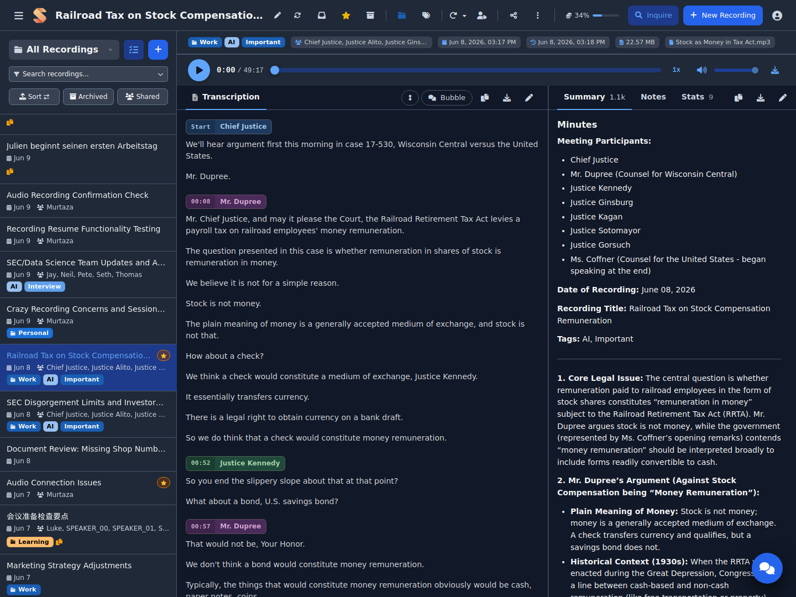
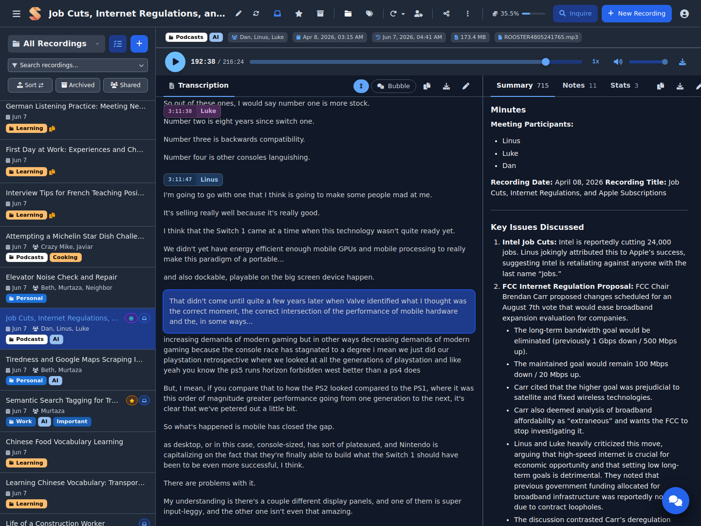

# Welcome to Speakr

Speakr is a powerful self-hosted transcription platform that helps you capture, transcribe, and understand your audio content. Whether you're recording meetings, interviews, lectures, or personal notes, Speakr transforms spoken words into valuable, searchable knowledge.

  

!!! success "Latest Release: v0.10.17-alpha: SSO security update, share permissions, folder fixes"
    An Authlib security update for SSO, read-only query-string tokens, permission changes on existing shares, a searchable share window and folder fixes.

    See the [full release notes](https://github.com/murtaza-nasir/speakr/releases/tag/v0.10.17-alpha) for details.

## Quick Navigation

  

    <h3>Getting Started</h3>
    
New to Speakr? Start here for a quick overview and setup guide.

    <a href="getting-started" class="card-link">Get Started →</a>
  

  
  

    <h3>Installation</h3>
    
Step-by-step instructions for Docker and manual installation.

    <a href="getting-started/installation" class="card-link">Install Now →</a>
  

  
  

    <h3>User Guide</h3>
    
Learn how to <a href="user-guide/recording">record</a>, <a href="user-guide/transcripts">transcribe</a>, and manage your audio content.

    <a href="user-guide/" class="card-link">Learn More →</a>
  

  
  

    <h3>Admin Guide</h3>
    
Configure <a href="admin-guide/user-management">users</a>, <a href="admin-guide/prompts">system settings</a>, and manage your instance.

    <a href="admin-guide/" class="card-link">Configure →</a>
  

  
  

    <h3>FAQ</h3>
    
Find answers to commonly asked questions about Speakr.

    <a href="faq" class="card-link">View FAQ →</a>
  

  
  

    <h3>Troubleshooting</h3>
    
Solutions for <a href="troubleshooting#transcription-problems">transcription issues</a> and <a href="troubleshooting#performance-issues">performance problems</a>.

    <a href="troubleshooting" class="card-link">Get Help →</a>
  

## Core Features

Speakr takes a recording from raw audio to organized, searchable, shareable knowledge. The pipeline:

  

    <h4>Capture</h4>
    <ul>
      <li><a href="user-guide/recording">Mic, system/tab audio, or both mixed</a></li>
      <li>Hours-long server-side recording sessions</li>
      <li>Drag-and-drop upload and black-hole auto-import</li>
    </ul>
  

  

    <h4>Transcribe</h4>
    <ul>
      <li><a href="features#multi-engine-support">Bring your own engine: WhisperX, OpenAI, Mistral, custom ASR</a></li>
      <li><a href="features#speaker-diarization">Speaker diarization</a> and <a href="features#speaker-management">voice profiles</a> (WhisperX backend)</li>
      <li><a href="features#language-support">Auto-detect plus the full Whisper language list</a></li>
      <li>Custom vocabulary and hotwords (most effective with WhisperX)</li>
    </ul>
  

  

    <h4>Understand</h4>
    <ul>
      <li><a href="features#automatic-summarization">Customizable AI summaries</a></li>
      <li>Event extraction and per-recording chat</li>
      <li><a href="user-guide/inquire-mode">Inquire Mode: semantic search across everything</a></li>
    </ul>
  

  

    <h4>Organize</h4>
    <ul>
      <li><a href="features#tagging-system">Smart tags with custom prompts, stackable</a></li>
      <li>Folders and bulk operations</li>
      <li><a href="features#retention-policies-and-auto-deletion">Retention policies and auto-deletion</a></li>
    </ul>
  

  

    <h4>Collaborate</h4>
    <ul>
      <li><a href="user-guide/sharing">Granular internal sharing and public links</a></li>
      <li>Groups with auto-share group tags</li>
      <li><a href="features#single-sign-on-sso">Multi-user with Single Sign-On (OIDC)</a></li>
    </ul>
  

  

    <h4>Automate</h4>
    <ul>
      <li><a href="user-guide/api-reference">REST API v1 with Swagger UI</a></li>
      <li><a href="features#webhooks">Signed webhooks</a> on lifecycle events</li>
      <li>n8n, Zapier, Make integration</li>
    </ul>
  

## Interactive Audio Synchronization

Experience seamless bidirectional synchronization between your audio and transcript. Click any part of the transcript to jump directly to that moment in the audio, or watch as the system automatically highlights the currently spoken text as the audio plays. Enable auto-scroll follow mode to keep the active segment centered in view, creating an effortless reading experience for even the longest recordings.

  
  
Real-time transcript highlighting synchronized with audio playback, with auto-scroll follow mode

Learn more about [audio synchronization features](user-guide/transcripts.md#audio-synchronization-and-follow-mode) in the user guide.

!!! tip "Transform Your Recordings with Custom Tag Prompts"
    Tags aren't just for organization - they transform content. Create a "Recipe" tag to convert cooking narration into formatted recipes. Use "Study Notes" tags to turn lecture recordings into organized outlines. Stack tags like "Client Meeting" + "Legal Review" for combined analysis. Learn more in the [Custom Prompts guide](admin-guide/prompts.md#creative-tag-prompt-use-cases).

## Latest Updates

!!! info "Version 0.10.17-alpha - SSO security update, share permissions, folder fixes"
    Two indexes are added at startup. Set `TRUSTED_PROXIES` to the reverse proxy address, and send API tokens in the `Authorization` header for writes.

    - **Security** - Authlib 1.9.1 for SSO, query-string tokens only for reading (#500), and sign-in required for the app configuration and system info (#499, #502).
    - **Sharing** - Permissions on an existing share can be changed, and several people can be selected in the share window (discussions #517, #519).
    - **Folders** - Name and color checks, group folder names unique in the group, and group sharing through the API (#511 to #516).
    - **Fixes** - SSO sign-in (#496), upload formats (#510), the storage quota (#509), and recording sessions (#505).

!!! info "Version 0.10.16-alpha - Tencent Cloud ASR, interface language, API limits"
    One column and seven indexes are added at startup; no configuration changes are required.

    - **Transcription** - A Tencent Cloud ASR connector with speaker diarization (#427), and request parameters for the text and chat models.
    - **Language** - Dates, times, numbers, percentages and file sizes follow the interface language (#477, #480, #481).
    - **API** - Account-wide limits and a cap on active tokens (discussion #484), and a CSRF check on the token API (#478).
    - **Fixes** - Faster recording lists (discussion #483), clear errors for unreadable uploads (#482), and #475, #476, #479, #485.

!!! info "Version 0.10.15-alpha - Security fixes, find and replace, notes in summaries"
    Two columns and one index are added at startup. Set `APP_BASE_URL` if Speakr sends email, and `TRUSTED_PROXY_HOPS=0` if no reverse proxy is in front of it.

    - **Security** - Email links, the remember-me cookie, recording files, summary display, the share target, Markdown rendering and gunicorn (#434 to #439, #442).
    - **Transcripts** - Find and replace in the transcript editors, and notes given to the summarizer as context (#440).
    - **Inquire and API** - A folder filter in Inquire (#428), and an operationId on every API operation (#443).
    - **Fixes** - Long file names (#430), recordings deleted during transcription (#432), and dependencies pinned and verified.

!!! note "Earlier releases"
    Release notes for v0.10.14 and earlier are on the [GitHub Releases page](https://github.com/murtaza-nasir/speakr/releases).

## Getting Help

Need assistance? We're here to help:

  

    <h4>Documentation</h4>
    
You're already here! Browse our comprehensive guides:

    <ul>
      <li><a href="faq">Frequently Asked Questions</a></li>
      <li><a href="troubleshooting">Troubleshooting Guide</a></li>
      <li><a href="user-guide/">User Documentation</a></li>
      <li><a href="admin-guide/">Admin Documentation</a></li>
    </ul>
  

  
  

    <h4>Community</h4>
    
Connect with other users and get support:

    <ul>
      <li><a href="https://github.com/murtaza-nasir/speakr/issues">Report Issues</a></li>
      <li><a href="https://github.com/murtaza-nasir/speakr/discussions">Join Discussions</a></li>
      <li><a href="https://github.com/murtaza-nasir/speakr">Star on GitHub</a></li>
    </ul>
  

---

Ready to transform your audio into actionable insights? [Get started now](getting-started.md) →