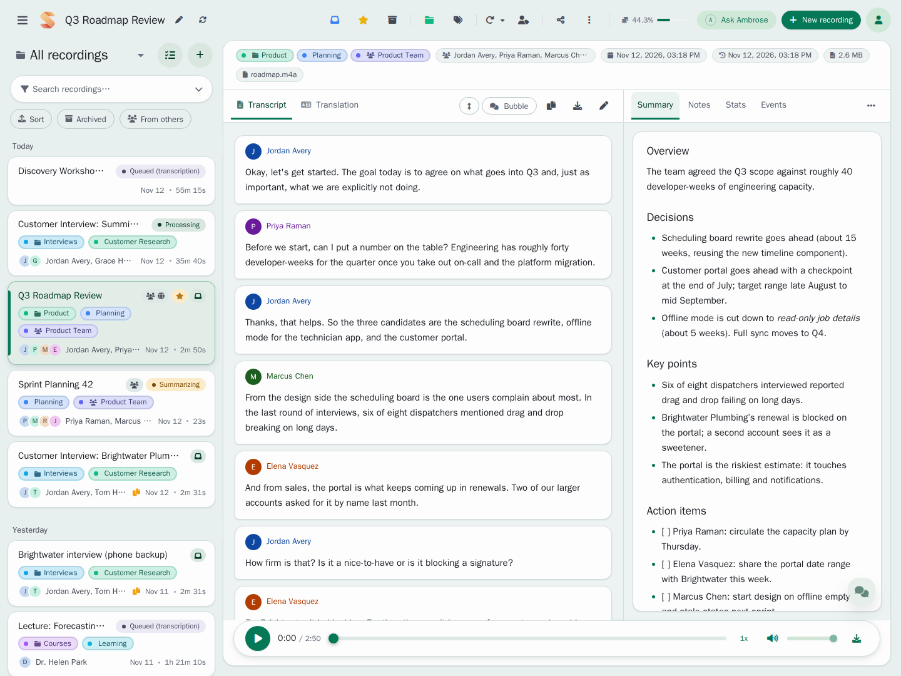
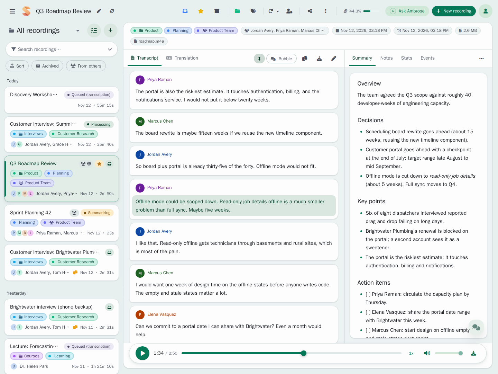

# Welcome to Speakr

Speakr is a powerful self-hosted transcription platform that helps you capture, transcribe, and understand your audio content. Whether you're recording meetings, interviews, lectures, or personal notes, Speakr transforms spoken words into valuable, searchable knowledge.

  

!!! success "Latest Release: v0.10.22-alpha: Accounts from SSO, themed notifications, tablet and phone layout"
    Apps with the same single sign-on can create Speakr accounts on first use, each with its own scope limit, notifications follow the interface theme, and the tablet and phone layouts are fixed.

    See the [full release notes](https://github.com/murtaza-nasir/speakr/releases/tag/v0.10.22-alpha) for details.

## Quick Navigation

  

    <h3>Getting Started</h3>
    
New to Speakr? Start here for a quick overview and setup guide.

    <a href="getting-started" class="card-link">Get Started →</a>
  

  
  

    <h3>Installation</h3>
    
Step-by-step instructions for Docker and manual installation.

    <a href="getting-started/installation" class="card-link">Install Now →</a>
  

  
  

    <h3>User Guide</h3>
    
Learn how to <a href="user-guide/recording">record</a>, <a href="user-guide/transcripts">transcribe</a>, and manage your audio content.

    <a href="user-guide/" class="card-link">Learn More →</a>
  

  
  

    <h3>Admin Guide</h3>
    
Configure <a href="admin-guide/user-management">users</a>, <a href="admin-guide/prompts">system settings</a>, and manage your instance.

    <a href="admin-guide/" class="card-link">Configure →</a>
  

  
  

    <h3>FAQ</h3>
    
Find answers to commonly asked questions about Speakr.

    <a href="faq" class="card-link">View FAQ →</a>
  

  
  

    <h3>Troubleshooting</h3>
    
Solutions for <a href="troubleshooting#transcription-problems">transcription issues</a> and <a href="troubleshooting#performance-issues">performance problems</a>.

    <a href="troubleshooting" class="card-link">Get Help →</a>
  

## Core Features

Speakr takes a recording from raw audio to organized, searchable, shareable knowledge. The pipeline:

  

    <h4>Capture</h4>
    <ul>
      <li><a href="user-guide/recording">Mic, system/tab audio, or both mixed</a></li>
      <li>Hours-long server-side recording sessions</li>
      <li>Drag-and-drop upload and black-hole auto-import</li>
    </ul>
  

  

    <h4>Transcribe</h4>
    <ul>
      <li><a href="features#multi-engine-support">Bring your own engine: WhisperX, OpenAI, Mistral, custom ASR</a></li>
      <li><a href="features#speaker-diarization">Speaker diarization</a> and <a href="features#speaker-management">voice profiles</a> (WhisperX backend)</li>
      <li><a href="features#language-support">Auto-detect plus the full Whisper language list</a></li>
      <li>Custom vocabulary and hotwords (most effective with WhisperX)</li>
    </ul>
  

  

    <h4>Understand</h4>
    <ul>
      <li><a href="features#automatic-summarization">Customizable AI summaries</a></li>
      <li>Event extraction and per-recording chat</li>
      <li><a href="user-guide/inquire-mode">Inquire Mode: semantic search across everything</a></li>
    </ul>
  

  

    <h4>Organize</h4>
    <ul>
      <li><a href="features#tagging-system">Smart tags with custom prompts, stackable</a></li>
      <li>Folders and bulk operations</li>
      <li><a href="features#retention-policies-and-auto-deletion">Retention policies and auto-deletion</a></li>
    </ul>
  

  

    <h4>Collaborate</h4>
    <ul>
      <li><a href="user-guide/sharing">Granular internal sharing and public links</a></li>
      <li>Groups with auto-share group tags</li>
      <li><a href="features#single-sign-on-sso">Multi-user with Single Sign-On (OIDC)</a></li>
    </ul>
  

  

    <h4>Automate</h4>
    <ul>
      <li><a href="user-guide/api-reference">REST API v1 with Swagger UI</a></li>
      <li><a href="features#webhooks">Signed webhooks</a> on lifecycle events</li>
      <li>n8n, Zapier, Make integration</li>
    </ul>
  

## Interactive Audio Synchronization

Experience seamless bidirectional synchronization between your audio and transcript. Click any part of the transcript to jump directly to that moment in the audio, or watch as the system automatically highlights the currently spoken text as the audio plays. Enable auto-scroll follow mode to keep the active segment centered in view, creating an effortless reading experience for even the longest recordings.

  
  
Real-time transcript highlighting synchronized with audio playback, with auto-scroll follow mode

Learn more about [audio synchronization features](user-guide/transcripts.md#audio-synchronization-and-follow-mode) in the user guide.

!!! tip "Transform Your Recordings with Custom Tag Prompts"
    Tags aren't just for organization - they transform content. Create a "Recipe" tag to convert cooking narration into formatted recipes. Use "Study Notes" tags to turn lecture recordings into organized outlines. Stack tags like "Client Meeting" + "Legal Review" for combined analysis. Learn more in the [Custom Prompts guide](admin-guide/prompts.md#creative-tag-prompt-use-cases).

## Latest Updates

!!! info "Version 0.10.22-alpha - Accounts from SSO, themed notifications, layout fixes"
    Three settings are added at startup without a value; account creation from access tokens is off until an admin turns it on. Read the Upgrading section of the release notes for the changes to token exchange and webhooks.

    - **Single sign-on** - Accounts created on first use from an SSO access token, scope limits and display names per app.
    - **Interface** - Notifications in the interface theme, the recording header on tablets and portrait videos on phones.
    - **Fixes** - Shares after tag group changes, failure notices for empty and over-budget transcriptions, and `.weba` files in the watch folder.

!!! info "Version 0.10.21-alpha - SSO access tokens, people in Ambrose, sharing and job fixes"
    One column and four settings are added at startup; SSO access tokens are off until an admin turns them on. Read the Upgrading section of the release notes for the changes to webhooks and API v1.

    - **Single sign-on** - SSO access tokens on the API, for Open WebUI and for apps that sync in the background.
    - **Ambrose** - People are found by any of their names, and long Sources lists are folded.
    - **Fixes** - Sharing and permissions (#586, #589, #591, #598 to #600), jobs and uploads (#587, #592, #594 to #597, #601), error pages from transcription services (#593), and cut-off summaries.

!!! info "Version 0.10.20-alpha - Interface themes, Ambrose, nested folders"
    Eight columns are added at startup, and recordings left without an owner by earlier versions are removed by a daily step. New accounts start with the Cards theme; read the Upgrading section of the release notes for the defaults and how to keep the previous ones.

    - **Interface** - Six themes with every color scheme and dark mode, and a What's new list after each update.
    - **Ambrose** - One assistant for the recording chat and Inquire, with cited answers and a chat per recording.
    - **Folders and prompts** - Nested folders (PR #585) and the Regenerate summary dialog (#584).
    - **Administration and sharing** - `.env` settings in System Settings (#567), group shares that follow the group (#570, #582), and fixes for #571, #572, #578, #579, #581 and #583.

!!! info "Version 0.10.19-alpha - Transcript translation, faster uploads, fair queues"
    Five columns and a unique index on active processing jobs are added at startup. Uploads are converted by convert jobs (`CONVERT_QUEUE_WORKERS`, default 2); read the release notes before going back to an earlier version.

    - **Translation** - Transcripts can be translated on demand or automatically, with an optional separate translation model (PR #538).
    - **Processing** - Uploads are answered before conversion, every user gets a turn in the queues, and Inquire indexing has its own worker (discussions #541 to #543).
    - **Watch folder** - Watched files go through the upload pipeline without its size limits, and a file that cannot be processed is renamed to `<name>.failed` (PR #552).
    - **Fixes** - Recordings made on iPhones (#495), `.local` email addresses (#551), seeking in long videos (#539), and #530 to #534.

!!! note "Earlier releases"
    Release notes for v0.10.18 and earlier are on the [GitHub Releases page](https://github.com/murtaza-nasir/speakr/releases).

## Getting Help

Need assistance? We're here to help:

  

    <h4>Documentation</h4>
    
You're already here! Browse our comprehensive guides:

    <ul>
      <li><a href="faq">Frequently Asked Questions</a></li>
      <li><a href="troubleshooting">Troubleshooting Guide</a></li>
      <li><a href="user-guide/">User Documentation</a></li>
      <li><a href="admin-guide/">Admin Documentation</a></li>
    </ul>
  

  
  

    <h4>Community</h4>
    
Connect with other users and get support:

    <ul>
      <li><a href="https://github.com/murtaza-nasir/speakr/issues">Report Issues</a></li>
      <li><a href="https://github.com/murtaza-nasir/speakr/discussions">Join Discussions</a></li>
      <li><a href="https://github.com/murtaza-nasir/speakr">Star on GitHub</a></li>
    </ul>
  

---

Ready to transform your audio into actionable insights? [Get started now](getting-started.md) →