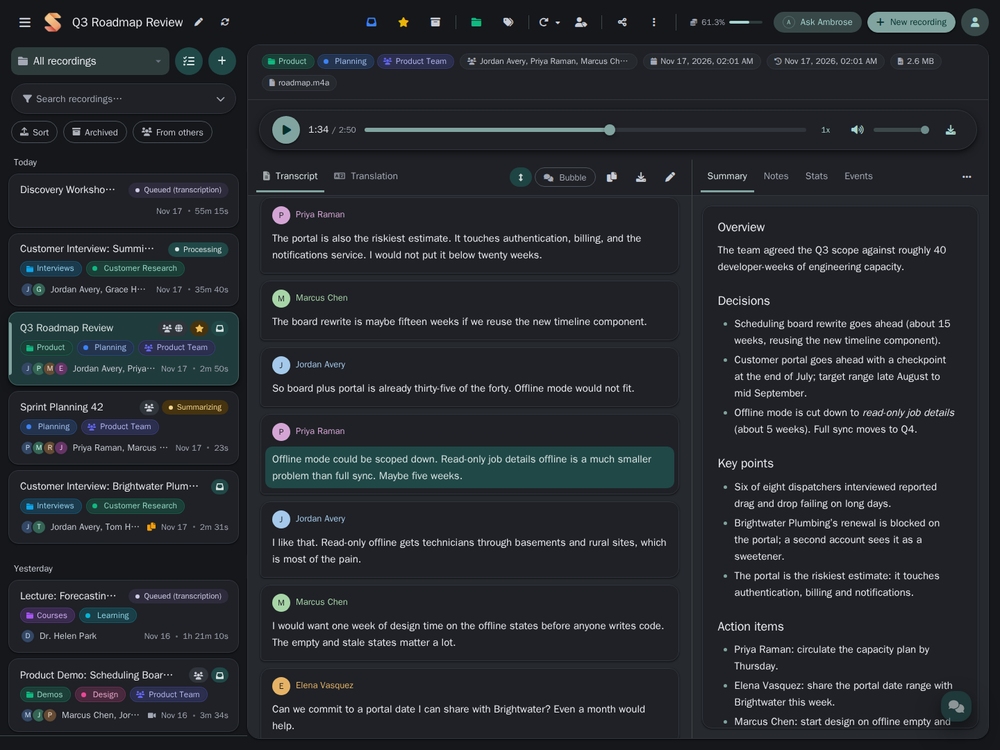

# Welcome to Speakr

Speakr is a powerful self-hosted transcription platform that helps you capture, transcribe, and understand your audio content. Whether you're recording meetings, interviews, lectures, or personal notes, Speakr transforms spoken words into valuable, searchable knowledge.

  

!!! success "Latest Release: v0.11.7: SSO account linking fix, player reload after conversion, faster startup"
    Pending SSO account links are completed only for the user who requested the link. The players are reloaded with the new file after a conversion or trim. The Loading overlay is removed before the startup requests are completed.

    See the [full release notes](https://github.com/murtaza-nasir/speakr/releases/tag/v0.11.7) for details.

## Quick Navigation

  

    <h3>Getting Started</h3>
    
New to Speakr? Start here for a quick overview and setup guide.

    <a href="getting-started" class="card-link">Get Started →</a>
  

  
  

    <h3>Installation</h3>
    
Step-by-step instructions for Docker and manual installation.

    <a href="getting-started/installation" class="card-link">Install Now →</a>
  

  
  

    <h3>User Guide</h3>
    
Learn how to <a href="user-guide/recording">record</a>, <a href="user-guide/transcripts">transcribe</a>, and manage your audio content.

    <a href="user-guide/" class="card-link">Learn More →</a>
  

  
  

    <h3>Admin Guide</h3>
    
Configure <a href="admin-guide/user-management">users</a>, <a href="admin-guide/prompts">system settings</a>, and manage your instance.

    <a href="admin-guide/" class="card-link">Configure →</a>
  

  
  

    <h3>FAQ</h3>
    
Find answers to commonly asked questions about Speakr.

    <a href="faq" class="card-link">View FAQ →</a>
  

  
  

    <h3>Troubleshooting</h3>
    
Solutions for <a href="troubleshooting#transcription-problems">transcription issues</a> and <a href="troubleshooting#performance-issues">performance problems</a>.

    <a href="troubleshooting" class="card-link">Get Help →</a>
  

## Core Features

Speakr takes a recording from raw audio to organized, searchable, shareable knowledge. The pipeline:

  

    <h4>Capture</h4>
    <ul>
      <li><a href="user-guide/recording">Mic, system/tab audio, or both mixed</a></li>
      <li>Hours-long server-side recording sessions</li>
      <li>Drag-and-drop upload and black-hole auto-import</li>
    </ul>
  

  

    <h4>Transcribe</h4>
    <ul>
      <li><a href="features#multi-engine-support">Bring your own engine: WhisperX, OpenAI, Mistral, AssemblyAI, Tencent, audio.cpp and custom ASR</a></li>
      <li><a href="features#speaker-diarization">Speaker diarization</a> and <a href="features#speaker-management">voice profiles</a> (every backend that returns speaker embeddings, such as WhisperX or OpenASR from openasr#379 onward)</li>
      <li><a href="features#language-support">Auto-detect plus the full Whisper language list</a></li>
      <li>Custom vocabulary and hotwords (most effective with WhisperX)</li>
    </ul>
  

  

    <h4>Understand</h4>
    <ul>
      <li><a href="features#automatic-summarization">Customizable AI summaries</a></li>
      <li>Event extraction and per-recording chat</li>
      <li><a href="user-guide/inquire-mode">Ask Ambrose: semantic search across everything</a></li>
    </ul>
  

  

    <h4>Organize</h4>
    <ul>
      <li><a href="features#tagging-system">Smart tags with custom prompts, stackable</a></li>
      <li>Folders and bulk operations</li>
      <li><a href="features#retention-policies-and-auto-deletion">Retention policies and auto-deletion</a></li>
    </ul>
  

  

    <h4>Collaborate</h4>
    <ul>
      <li><a href="user-guide/sharing">Granular internal sharing and public links</a></li>
      <li>Groups with auto-share group tags</li>
      <li><a href="features#single-sign-on-sso">Multi-user with Single Sign-On (OIDC)</a></li>
    </ul>
  

  

    <h4>Automate</h4>
    <ul>
      <li><a href="user-guide/api-reference">REST API v1 with Swagger UI</a></li>
      <li><a href="features#webhooks">Signed webhooks</a> on lifecycle events</li>
      <li>n8n, Zapier, Make integration</li>
    </ul>
  

## Interactive Audio Synchronization

Experience seamless bidirectional synchronization between your audio and transcript. Click any part of the transcript to jump directly to that moment in the audio, or watch as the system automatically highlights the currently spoken text as the audio plays. Enable auto-scroll follow mode to keep the active segment centered in view, creating an effortless reading experience for even the longest recordings.

  
  
Real-time transcript highlighting synchronized with audio playback, with auto-scroll follow mode

Learn more about [audio synchronization features](user-guide/transcripts.md#audio-synchronization-and-follow-mode) in the user guide.

!!! tip "Transform Your Recordings with Custom Tag Prompts"
    Tags aren't just for organization - they transform content. Create a "Recipe" tag to convert cooking narration into formatted recipes. Use "Study Notes" tags to turn lecture recordings into organized outlines. Stack tags like "Client Meeting" + "Legal Review" for combined analysis. Learn more in the [Custom Prompts guide](admin-guide/prompts.md#creative-tag-prompt-use-cases).

## Latest Updates

!!! info "Version 0.11.7 - SSO account linking fix, player reload after conversion, faster startup"
    - **Security** - A pending SSO account link is completed only for the user who requested it (GHSA-w7wf-8p3w-rmj7).
    - **Playback** - The players reload the new file when a recording is converted, trimmed or reprocessed.
    - **Startup** - The Loading overlay is removed before the startup requests finish.

!!! info "Version 0.11.6 - One Transcription models section, audio.cpp, kept upload span"
    - **Administration** - One Transcription models section in System settings, with a connector, address and key per model, a test before it is offered to users, and the default model.
    - **Transcription** - An audio.cpp connector, with speaker labels when the model assigns them.
    - **Uploads** - A chosen span of an uploaded file is kept before it is transcribed.
    - **Fixes** - The open recording is kept when a job of another recording finishes.

!!! info "Version 0.11.5 - Query tokens refused, single-use links, hardened delivery"
    - **Security** - API tokens in the `?token=` query parameter are refused by default. `API_QUERY_TOKENS_ENABLED=true` accepts them again.
    - **Accounts** - Password reset and verification links are stored as hashes and can be used once.
    - **Hardening** - CSRF checks on every request, markup escaped through one helper, and webhook deliveries limited to the addresses validated for their host.
    - **Push** - The VAPID key pair is kept on the data volume, so subscriptions outlive an update.

!!! info "Version 0.11.4 - Offline recorder sources, models from the admin panel, route validation"
    - **Offline recorder** - The page records the microphone, the system audio or both, as the in-app recorder does.
    - **Models** - Text, chat and translation models are configured from the admin panel without a restart.
    - **Validation** - Request bodies and fields are checked at the route boundary on the web and API v1 alike.

!!! info "Version 0.11.3 - Offline recording, upload once, gpt-transcribe"
    - **Offline recorder** - A page to record on while offline, and the upload happens once when the connection returns.
    - **Uploads** - A recording whose upload failed is uploaded once.
    - **OpenAI** - `gpt-transcribe` support, and a note that OpenAI shuts down `whisper-1` and the `gpt-4o` transcription models on 26 February 2027.

!!! info "Version 0.11.2 - Chat limits, error references, Unicode search"
    - **Chat** - Question and history limits, and a documented contract for the unescaped Markdown answer that clients must sanitize.
    - **Errors** - An unexpected route error answers with a fixed message and a reference, and the exception text goes only to the log.
    - **Search** - Unicode search on SQLite, and date filters that are validated instead of applied when malformed.

!!! note "Earlier releases"
    Release notes for v0.11.1 and earlier are on the [GitHub Releases page](https://github.com/murtaza-nasir/speakr/releases).

## Getting Help

Need assistance? We're here to help:

  

    <h4>Documentation</h4>
    
You're already here! Browse our comprehensive guides:

    <ul>
      <li><a href="faq">Frequently Asked Questions</a></li>
      <li><a href="troubleshooting">Troubleshooting Guide</a></li>
      <li><a href="user-guide/">User Documentation</a></li>
      <li><a href="admin-guide/">Admin Documentation</a></li>
    </ul>
  

  
  

    <h4>Community</h4>
    
Connect with other users and get support:

    <ul>
      <li><a href="https://github.com/murtaza-nasir/speakr/issues">Report Issues</a></li>
      <li><a href="https://github.com/murtaza-nasir/speakr/discussions">Join Discussions</a></li>
      <li><a href="https://github.com/murtaza-nasir/speakr">Star on GitHub</a></li>
    </ul>
  

---

Ready to transform your audio into actionable insights? [Get started now](getting-started.md) →