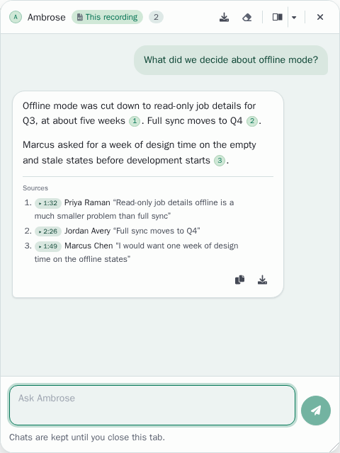
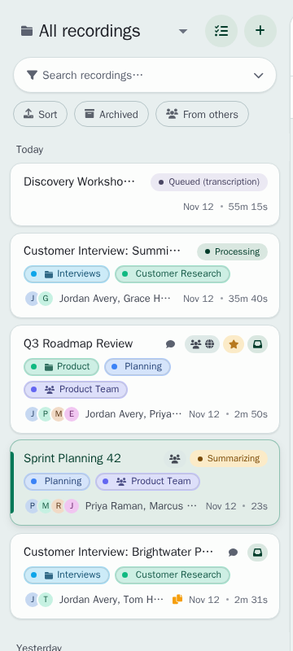
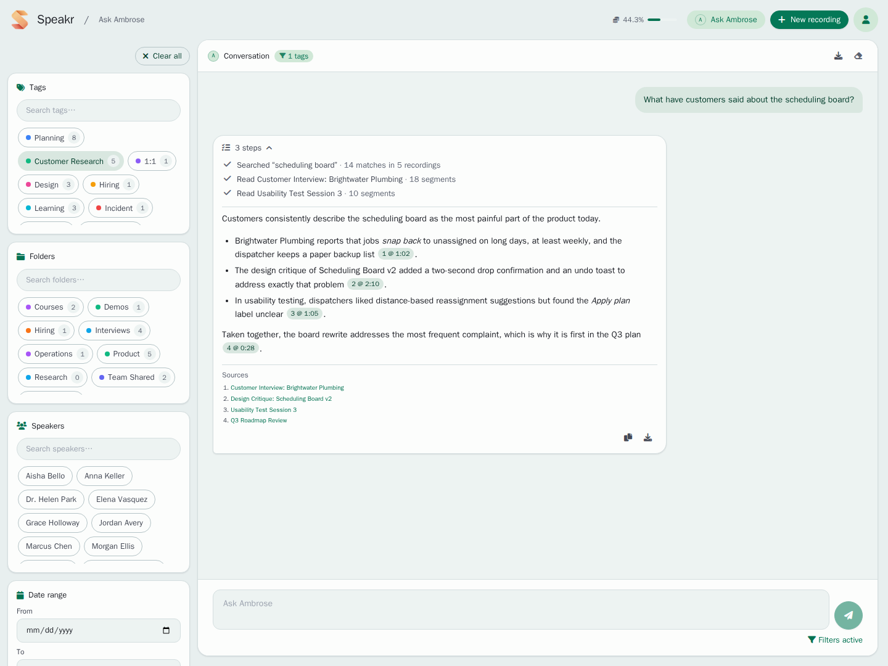

# Ambrose

Ambrose is the assistant in Speakr. You can ask it questions in two places:

- **The recording chat**: questions about the recording you have open. It opens with the round button at the bottom right of a recording, or with the Ambrose tab on a phone.
- **The Ask page**: questions about all your recordings at once, or about the recordings that match a set of filters. It opens with **Ask Ambrose** in the header. See [Ask Ambrose](inquire-mode.md).

Answers cite the transcript, so you can check each statement against what was said.

## Renaming the assistant

Ambrose is the default name. To use another name, go to Account → Preferences → **Assistant** and type the new name (see [Settings](settings.md#assistant)). The name appears in the recording chat, on the Ask page, on the header button and in the monogram, which shows its first letter. Leave the field empty to go back to Ambrose. This guide uses the default name.

## The recording chat

The header of the chat shows the monogram, the name and a scope chip reading **This recording**. Type a question in the box marked "Ask Ambrose" and press Enter to send it. For a new line, press Ctrl+Enter.

Ambrose answers from the full transcript of the recording, its participants and your notes on it. Earlier questions in the chat are kept in mind, so you can ask follow-up questions such as "What solutions were proposed?" after a question about the budget.

For tips on questions and for the export buttons, see [Ask Ambrose about a recording](transcripts.md#ask-ambrose-about-a-recording).

### Chats per recording

Each recording has its own chat. When you open another recording, its own chat is shown, and the chat of the first recording is still there when you come back.

- Chats are kept in the browser tab. They survive a page reload and are removed when you close the tab. The line "Chats are kept until you close this tab." under the chat box is a reminder.
- Up to 20 recordings keep a chat. When a 21st recording gets one, the chat you used least recently is removed.
- A small chat icon on a recording's row in the sidebar marks a recording with a chat in this tab. Empty chats and incognito recordings have no icon.
- You can open another recording while an answer is still arriving. The answer goes on in the chat of its own recording, and the chat icon on that recording's row pulses while Ambrose is answering.
- When the answer is ready, a short message with the name of the recording appears, such as "Ambrose answered in Weekly sync". Click the message to open that recording. If Ambrose could not answer, the message reads "Ambrose couldn't answer in" and the name.

Download a chat before you close the tab if you want to keep it.

### Incognito recordings

An incognito recording has a chat as well, with these differences:

- The chat is never stored. It is removed when you open another recording or close the tab.
- Ambrose answers from the transcript of the incognito recording only. It does not search your other recordings.

## Citations

Ambrose supports statements with citations, shown as small numbers in the answer.

- **In the recording chat**, each number stands for a passage of the transcript. Click a number to play the recording from that moment. Below the answer, a **Sources** list gives each number with its time, its speaker and the quoted words. Click the time to play from there. When the quoted words are not in the cited passage, the source is marked "Quote not found in the transcript".
- **Citations of other recordings** are links such as "2 @ 14:05". Click a link to open that recording at that moment. In the Sources list, click a title to open its recording.

The numbers stay the same for the whole chat, so a follow-up such as "tell me more about 3" refers to the source you saw.

When an answer has more than three sources, the list is folded into **Sources (n)**. Click it to open the list.

## What Ambrose can search

On the Ask page, and in the recording chat when your administrator has turned on the agent, Ambrose can look through your library before it answers. Each step is shown while Ambrose works, for example "Searching for “budget”".

Ambrose can:

| Search | What it does |
|--------|--------------|
| Text | Find exact words, names, numbers and phrases in transcripts and titles, and in summaries and your notes when Ambrose may read them |
| Meaning | Find passages about a topic, even when other words were used, such as "cost overruns" for a question about budget concerns |
| Tags and folders | Limit a search or a list of recordings to some tags or folders; a folder includes its subfolders |
| Similar recordings | Rank the recordings most like one recording, by shared speakers, shared tags, folder, date and content |
| People | Find a person in your speaker profiles and among the participants of your recordings, by a first name, a surname, an email or another spelling, and list every name the person appears under |
| Transcripts | Read a whole transcript, part by part |
| Recording details | Read the title, date, participants, duration, tags and folder of a recording |
| Summaries | Read the summary of a recording, when summaries are allowed |
| Notes | Read your own notes on a recording, when notes are allowed |

Under Account → Prompt options → **What Ambrose can read**, you choose whether Ambrose may read summaries and your notes when it searches (see [Settings](settings.md#what-ambrose-can-read)). Transcripts are always available. Only your own notes are used, never the notes of other people on recordings shared with you.

Ambrose searches only the recordings you can open. On the Ask page, the filters set the limit: Ambrose can narrow a search within them and cannot go beyond them. In the recording chat, Ambrose uses the other recordings only when a question needs them, for example "Did we discuss this anywhere else?".

When the agent is off, Ambrose answers from the open recording only in the recording chat, and from one search of your library on the Ask page.

### Asking about a person

You can name a person the way you know them. In the recording chat, a first name, a surname or another spelling of a name (Mohammad, Mohammed or Muhammad) is matched to the participants of the open recording, and the answer says in a few words which participant was taken. When two participants fit equally, Ambrose asks which one you mean.

Searches of your library cover every name a person appears under. Those names come from your speaker profiles: the name, the other names and the email of each profile, and the names in the participant lists of your recordings. To connect a full name with the short name used in your recordings, add the full name as another name of the speaker profile, for example "Mohammad Najjar" for the speaker "Mohammed". Only your own speaker profiles are used.
