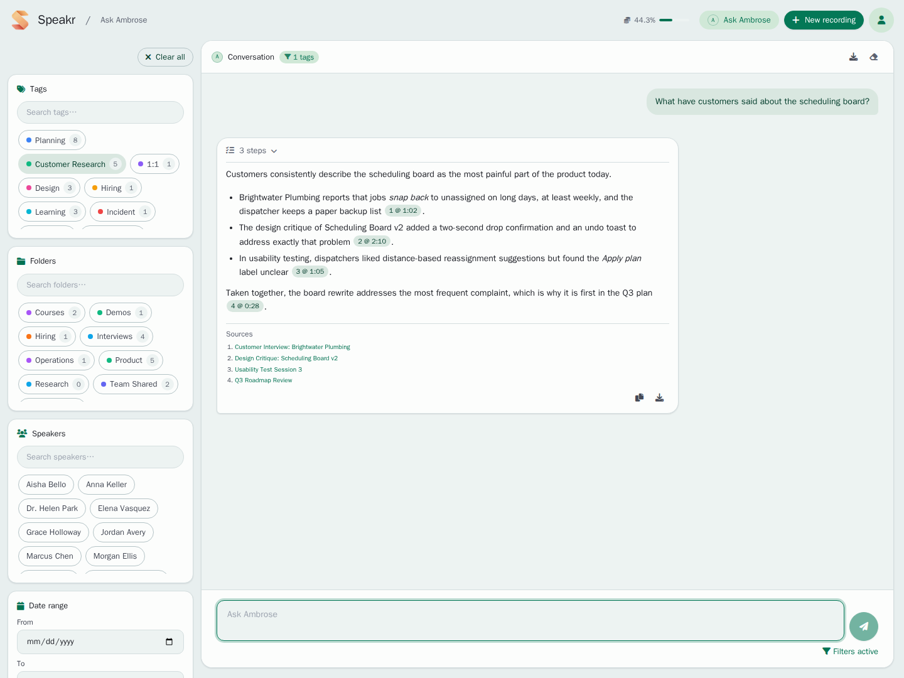

# Ask Ambrose (formerly Inquire)

**Ask Ambrose** is the library page of Speakr. On it you ask questions about all your recordings at once, or about the recordings that match a set of filters, and Ambrose answers with numbered citations that open each recording at the moment something was said. To ask about one recording only, use the assistant panel of that recording (see [Working with Transcripts](transcripts.md#ask-ambrose-about-a-recording)).

Ambrose is the default name of the assistant. You can give it another name under Account → Preferences → **Assistant** (see [Settings](settings.md#assistant)); the page, the header button and the recording panel then use that name. This guide uses the default.

## Opening the page

Click **Ask Ambrose** in the header, next to **+ New Recording**. The button carries Ambrose's monogram, the first letter of the name in a circle. The page lives at `/inquire`; `/ask` opens the same page.

The filters are on the left and the conversation on the right. Above the first question, a scope chip shows what Ambrose searches: **All recordings**, or a short summary of the active filters, such as "2 tags · Date Range". Type the question as you would ask a colleague and press Enter to send it; for a new line, press Ctrl+Enter. The same hint is shown on the send button when you hover over it.

Ambrose searches by meaning, not only by words. A question about "budget concerns" also finds discussions of cost overruns, funding or resource limits, even when those exact words were never spoken.

!!! tip "+ New Recording from the Ask page"
    The **+ New Recording** button in the header of the Ask page opens the main page with the upload dialog already open (`/?upload=1`). The parameter is removed from the address afterwards, so a refresh does not open the dialog again.

## Using filters to focus the search

The left column holds filters that limit the search to some recordings before you ask. This is useful in a large library.

With the tag filter you select recordings with specific tags, for example one project, one client or one kind of meeting. The count beside each tag shows how many recordings carry it.

The folder filter, shown when folders are enabled, limits the search to recordings in the selected folders. When tags and folders are both selected, only recordings that are in one of the selected folders and carry one of the selected tags are searched.

With the speaker filter you search what specific people said across recordings, for example to track commitments from one person.

The date range limits the search to recordings from a period, such as one quarter or one project phase.

The scope chip is updated as you change the filters.

## Downloading the conversation

Once the conversation has a question or an answer, a header appears above it. On the left are Ambrose's monogram, the word **Conversation** and the scope chip. On the right are two buttons: a download button and a **Clear conversation** button.

The download button saves the questions and answers on screen as a Word file named `inquire.docx`, titled "Ask Ambrose" (with the name you chose). Headings, lists, bold text and links in the answers are kept. Links become Word hyperlinks with full addresses, so a link to a recording opens that recording in Speakr. The address starts with `APP_BASE_URL` when the administrator has set it, and with the address you used to open Speakr otherwise. Each answer is followed by its Sources list, numbered as on screen, and the citation markers in the answer carry the same numbers, such as "2 @ 14:05". Each source title links to its recording. When tags, folders, speakers or dates are selected, their names appear under the export date. An answer that is still streaming, or one you stopped, is saved as far as it got.

Each finished answer also has a copy button and a download button at its bottom right, below its Sources list. With the copy button you copy the answer's text as Markdown. With the download button you save that answer and the question before it as a Word file named `inquire-response.docx`. The file has the same layout as the conversation download: the export date, the filter names, the answer's links and its Sources list. The two buttons appear once the answer has finished streaming.

**Clear conversation** removes the questions and answers and starts a new conversation; the filters stay as they are. An answer that is still streaming is stopped first. **Clear all** in the filter column removes the filters as well as the conversation. The conversation is not stored on the server, so download it before you leave or refresh the page.

## Asking Effective Questions

Answers are best when questions are clear and specific. Give context and say what you are looking for.

Instead of searching for single words like "deadline," ask complete questions like "What are the upcoming deadlines for the mobile app project?" This helps the AI understand not just what information you want, but why you want it and how to present it most usefully.

The system excels at different types of queries. You can ask for summaries of specific topics across multiple meetings, request lists of action items or decisions, search for specific statements or commitments, analyze patterns or trends in discussions, or identify problems and proposed solutions.

## Understanding Your Results

Ambrose answers with one synthesized answer that draws from all relevant recordings. The response isn't just a list of search hits - it's a coherent narrative that combines information from multiple sources into a unified answer.

Each piece of information includes a citation in the format (Recording ID: XX) that links directly to the source recording. Clicking these links takes you to the full recording where you can see the complete context. This transparency ensures you can always verify the information and dive deeper when needed.

The system intelligently organizes information, grouping related points together and presenting them in a logical flow. If multiple recordings discuss the same topic, the answer will synthesize these discussions, showing how the conversation evolved over time while maintaining clear attribution to each source.

## Practical Applications

The page is useful in many everyday situations. When preparing for meetings, you can quickly review what was previously discussed about agenda topics, what questions remained unresolved, and what commitments were made. This ensures you walk into meetings fully informed without spending hours reviewing old recordings.

For project management, the system helps track decisions across multiple meetings, identify all action items assigned to group members, and monitor how project requirements or priorities have changed over time. You can ask questions like "What risks have been identified for the product launch?" and receive a comprehensive list drawn from all relevant discussions.

Research and analysis become dramatically more efficient. Whether you're analyzing customer feedback patterns, tracking competitor mentions, or identifying recurring themes across interviews, Ambrose can surface insights that might otherwise remain buried in hours of recordings.

The system also serves as an excellent compliance and documentation tool. You can quickly find specific commitments made to clients, locate discussions about regulatory requirements, or verify what was agreed upon in negotiations. The citation system provides an audit trail back to the original recordings.

## Advanced Search Strategies

With some practice you can develop sophisticated search strategies. Start with broader questions to understand the landscape of available information, then drill down with increasingly specific queries. This iterative approach helps you discover information you might not have known to ask about directly.

Combine filters strategically. For instance, when preparing for a client meeting, filter by that client's tag and the relevant date range, then ask about outstanding issues or commitments. This focused approach yields highly relevant results without noise from unrelated recordings.

Pay attention to how the system interprets your questions. If results aren't quite what you expected, try rephrasing with different terms or adding more context. The system learns from the patterns in your recordings, so using terminology consistent with your actual discussions often yields better results.

## Technical Considerations

The search behind the page is based on meaning. When embeddings are enabled (with sentence-transformers installed), the system creates mathematical representations of meaning that allow it to understand concepts beyond simple keyword matching. This means it can find relevant information even when different words are used to express the same ideas.

Speakr defaults to the all-MiniLM-L6-v2 embedding model, a deliberately lightweight choice that balances performance with resource efficiency. This model generates 384-dimensional vectors and runs comfortably on CPU-only systems, which is crucial since most Speakr deployments are on standard servers or personal machines without dedicated GPUs. The default provides solid semantic understanding for conversational content while remaining responsive even when processing hundreds of recordings. Administrators who want a different trade-off can override the model via the `EMBEDDING_MODEL` environment variable, or offload embedding generation entirely to an OpenAI-compatible API provider (vLLM, OpenRouter, OpenAI, and similar) by setting `EMBEDDING_BASE_URL`. See [Model Configuration](../admin-guide/model-configuration.md#configurable-embedding-model) for details.

The system processes recordings in chunks, allowing it to search through even very long recordings efficiently. Diarized transcripts are chunked segment-aware: each chunk holds whole speaker turns rendered as `Speaker: text` lines, packed to roughly 1,400 characters, with a one-turn overlap between consecutive chunks. Because boundaries are size-based, not per-turn, a rapid back-and-forth exchange stays together in a single chunk with every speaker labeled inline. Each chunk also stores its dominant speaker and start and end timestamps, which is what allows search results and the citations on the Ask page to point at the moment in the recording where something was said. Administrators can keep the older plain character-window behavior with `CHUNKING_STRATEGY=legacy`; either way, existing indexed chunks are untouched by an upgrade until a recording is reindexed. The chunk size is tunable via `CHUNK_TARGET_CHARS`.

A note on changing embedding models: vectors from different models are not comparable, even when their dimensions happen to match. After switching `EMBEDDING_MODEL` or `EMBEDDING_BASE_URL` to a different model, re-embed the library (the admin dashboard's reprocessing tools, or reindex recordings individually) so search quality does not silently degrade.

Performance scales well with proper setup. The initial indexing of recordings happens automatically after transcription, and subsequent searches leverage this pre-computed index. Response times typically range from a few seconds for focused searches to slightly longer for complex queries across large libraries.

## Searching from Other Tools

Semantic search is also available through the API: `GET /api/v1/search?mode=semantic` (see the [API Reference](api-reference.md#search)). The same request without `mode=semantic` runs a keyword search over every recording, which works without library search.

## Agent mode (beta)

Administrators can enable an agentic mode with `ENABLE_INQUIRE_AGENT=true` (requires library search, `ENABLE_INQUIRE_MODE`, to be enabled). Instead of a single retrieval pass, an AI agent works iteratively: it searches your transcripts, lists recordings, and reads transcripts, summaries, or notes as needed, thinking between steps until it can answer. The interface shows each step live (what was searched, what was read, how many matches), a Stop button to interrupt, and a collapsed activity line on every answer so you can always see how a conclusion was reached. Answers cite their sources as compact numbered markers such as "2 @ 14:05": clicking one opens that recording and starts playback at the cited moment, and a Sources list at the end of each answer maps every number to its recording. The numbering stays stable through the conversation, so a follow-up like "tell me more about 3" refers to exactly what you saw.

A few examples show the difference from the classic search. Ask "what did we decide about the pricing change, and did anyone disagree?" and the agent will search for the pricing discussions, read the relevant transcript sections across several meetings, and answer with each position cited back to where it was said. Ask "summarize everything client X asked for this quarter" and it will list the recordings involving that client, read their summaries, and consolidate the requests with one citation per item. Ask "when did I first mention the migration plan?" and it will search, compare dates, and hand you a link that starts playback at that sentence. The classic search retrieves passages in one pass and answers from whatever that single search surfaced; the agent keeps working until the question is actually answered, which is the difference you feel on questions that span recordings or need a fact checked, not paraphrased.

The agent respects your privacy settings. Under Account, the **What Ambrose can read** section (formerly Inquire Privacy) controls what the agent may read: transcripts are always available (they are the minimum for the search to work), summaries are optional and on by default, and your notes are optional and off by default. A disabled content type is removed from the agent's toolbox entirely. Only your own notes are ever used, never notes on recordings shared with you. The active filter selection is a hard boundary: the agent can narrow its search within your filters but can never reach recordings outside them.

Long conversations are handled automatically. When the conversation grows past the context budget, older turns are folded into a summary the assistant keeps; a divider appears in the chat where this happened, and clicking it shows exactly what the assistant still remembers. A small meter next to the input shows how full the context is once it passes the halfway point.

Agentic answers involve several model calls per question, so they take longer (typically ten to thirty seconds for multi-step questions) and consume more tokens than the classic pipeline. Usage is tracked separately in the admin dashboard under the `inquire_agent` operation type. The agent works with any OpenAI-compatible endpoint: it uses native tool calling when the endpoint supports it and falls back to a prompted protocol when it does not. If the agent fails for any reason, the classic single-shot pipeline answers instead. See `config/env.transcription.example` for the tuning variables (step limits, timeouts, context budget, and availability defaults).

## Making the most of the Ask page

Answers are better when the recordings are good. Ensure your recordings have clear audio quality for accurate transcription, use speaker identification to track who said what, and apply consistent tags to organize your content. The better your input data, the more powerful your searches become.

Take advantage of the iterative nature of search. Start with a general question, review the results, then ask follow-up questions to drill deeper. The system maintains context within a session, making it easy to refine your search based on initial results.

The Ask page is for questions that span recordings. For questions about one recording, open it and ask Ambrose in its assistant panel: there Ambrose reads the whole transcript.

## Limitations to Keep in Mind

The search has limits. It searches only transcribed text, not audio directly, so any errors in transcription will affect search results. The system cannot infer information that isn't explicitly stated in recordings - it finds and synthesizes what was said, not what was meant but left unsaid.

Language support depends on the configured embedding model. The default all-MiniLM-L6-v2 was trained primarily on English, so non-English content works with varying results; switching to a multilingual model (e.g., `paraphrase-multilingual-MiniLM-L12-v2`) or a large API model such as `openai/text-embedding-3-large` significantly improves cross-lingual quality. Very long recordings might be summarized, not fully indexed, if they exceed processing limits. The system requires recordings to be fully processed before they are searchable, so very recent recordings may not appear immediately in results.

---

Next: [Sharing Recordings](sharing.md) →