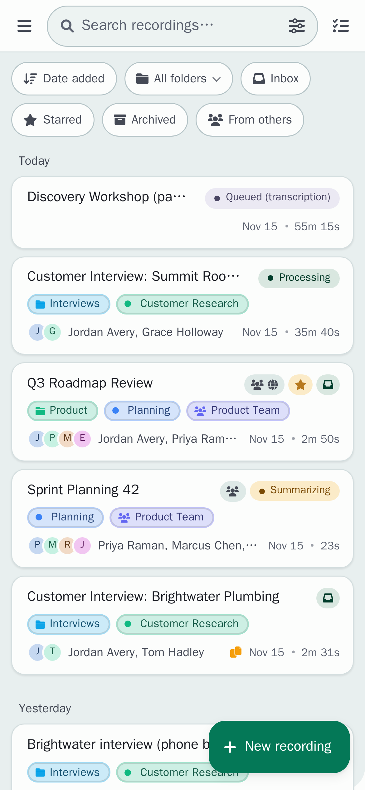
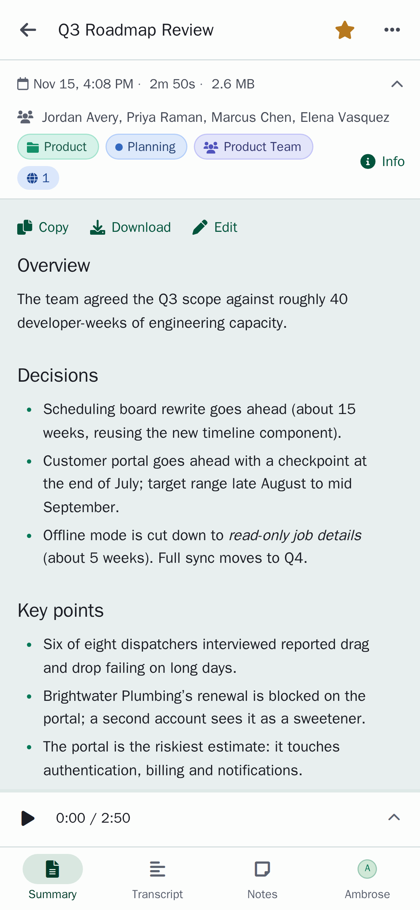
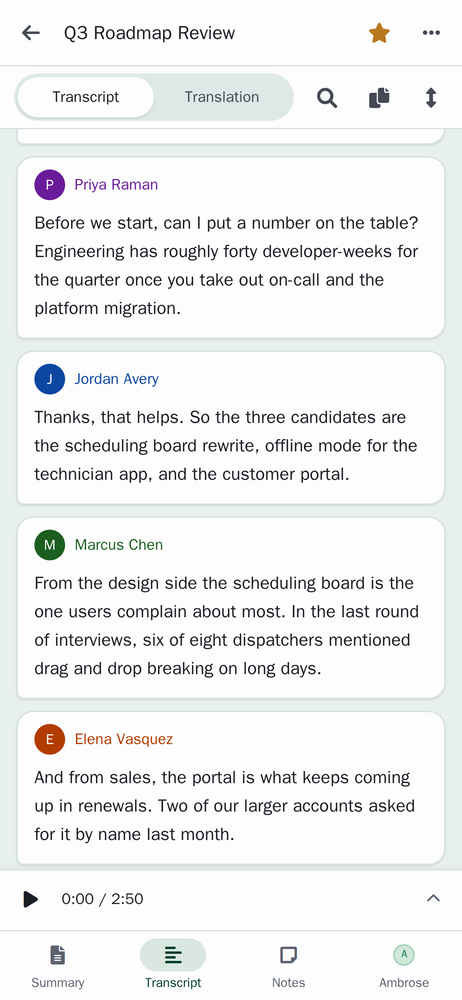

# Progressive Web App (PWA)

Speakr is a Progressive Web App that can be installed on your device for a more native-app like experience and wake lock support to prevent screen sleep during recording.

## What is a PWA?

A Progressive Web App combines the best of web and mobile apps:

- **Installable** - Add to your home screen like a native app
- **Fast loading** - Application files are kept in the browser
- **Wake lock** - Prevents screen from auto-sleeping during recording
- **No app store** - Install directly from your browser
- **Auto-updates** - Always get the latest version automatically
- **Offline recording** - When the server cannot be reached, a page to record on is shown; the recordings are uploaded when the server is back

## Installing Speakr as a PWA

### On Android (Chrome/Edge)

1. **Open Speakr** in Chrome or Edge browser
2. Look for the **"Add to Home Screen"** prompt at the bottom of the screen
3. Tap **"Add"** or **"Install"**
4. Alternatively:
    - Tap the three-dot menu (⋮) in the browser
    - Select **"Add to Home screen"** or **"Install app"**
    - Follow the prompts

5. **Launch** the app from your home screen

!!! tip "Banner Prompt"
    If you don't see the install prompt, you may need to visit Speakr a few times first. The browser will offer installation after detecting regular usage.

### On iOS (Safari)

1. **Open Speakr** in Safari
2. Tap the **Share** button (□↑) at the bottom of the screen
3. Scroll down and tap **"Add to Home Screen"**
4. Edit the name if desired and tap **"Add"**
5. **Launch** the app from your home screen

!!! note "iOS Limitations"
    iOS has some restrictions on PWAs:
    - Wake Lock API requires iOS 16.4+ (Safari 16.4+)
    - Background execution is more limited than Android
    - Some features work better on iOS 17+

### On Desktop (Chrome/Edge/Brave)

1. **Open Speakr** in your browser
2. Look for the **install icon** (⊕) in the address bar
3. Click it and select **"Install"**
4. Alternatively:
    - Click the three-dot menu
    - Select **"Install Speakr"** or **"Add to applications"**

5. **Launch** from your applications menu or desktop shortcut

## PWA Features

### Phone Layout

On a screen narrower than 768 px, the recording list and a recording are two separate screens. The layout is the same in every interface theme; a theme changes colors, shapes and type only.

**The recording list**

- The top bar holds the menu button, the search field and the button for selection mode. Tags, speakers, a date range and the other filters are opened with the button inside the search field.
- Under the top bar, filter chips are shown for the sort order, the folder, **Inbox**, **Starred**, **Archived** and **From others**. The chips are one row; the row is swiped sideways where the chips do not fit.
- Notifications, shared recordings, settings, the color scheme, dark mode and **Sign out** are found in the menu. The same menu leads to Ask Ambrose and, for administrators, to the admin pages.
- A recording is opened with a tap on its row.
- **New recording** is a button over the lower right corner of the list. The upload and record choices are opened with it.
- In selection mode, the actions for the selected recordings are shown in a bar at the bottom edge. Selection mode is left with **Done**.

**A recording**

- One top bar is shown: the back arrow to the list, the title on up to two lines, the star and **More**.
- The details block under the top bar is scrolled away with the text. Its first line gives the meeting date, the upload date when the recording was uploaded on another day, the length and the file size. Participants, the folder, tags and **Info** follow. The block is folded with a tap on its first line.
- **Info** opens a sheet with the full details: both dates with their times, the file name, the owner of a shared recording, processing times and the transcription hints. The meeting date and the participants are changed from this sheet.
- **More** opens the **Actions** sheet, in which every action for the recording is listed with a label: inbox, star and archive, folder, tags, rename, regenerate title, identify speakers, edit transcript, bubble view, download transcript, translate, reprocess, regenerate summary, events, speaker stats, share, download audio and the two delete actions. An action that the user's rights or the state of the recording do not allow is left out.
- Four tabs are always shown at the bottom: **Summary**, **Transcript**, **Notes** and the assistant. Events and speaker stats are opened as sheets, from **Actions** or from the two buttons at the right end of the row above the summary.
- **Copy**, **Download** and **Edit** are found above the summary and above the notes. The buttons for events and speaker stats are in the same row of the **Summary** tab, in the same place with and without a summary.
- An empty tab shows an icon, a title and one hint, at the same height in all four tabs.

**The transcript**

- A bar with the **Transcript** / **Translation** switch, find, copy and follow playback is pinned under the top bar. It remains in place while the transcript is scrolled, so the translation of the passage on screen is one tap away.
- Find works in transcripts of any length on a phone. Matches are marked in the text, and the arrows in the find bar lead to the previous and the next match.
- Bubble view, download, edit and translate are found in **Actions**.

**The player**

- One slim strip above the tabs shows play or pause, the position, the current speaker and a thin progress line.
- A tap on the strip opens the player sheet with a scrubber, back and forward by 15 seconds, the playback speeds and **Download audio**. For a video recording the sheet also holds the video and fullscreen controls.
- The player has no volume control on a phone. The volume is set with the keys of the phone.

**The assistant**

- The field for a question is shown on the assistant's tab only. It is one line high and grows with the text to about five lines.
- While the on-screen keyboard is open, the player strip, the tabs and the details block are hidden, so the chat and the field remain visible above the keyboard.

**Editors, uploads and the queue**

- The summary and notes editors fill the screen, with **Cancel** and **Save** in a footer under the editor.
- The upload dialog is a sheet that is dismissed with a downward drag on its header.
- While the processing queue has rows, a one-line strip is shown above the player strip, and at the foot of the recording list. The queue is opened as a sheet with a tap on the strip. See [Processing Queue](recording.md#processing-queue).
- Notifications are shown above the strip, the player and the tabs, and under the top bar while a sheet is open.

### Share to Speakr (Share Target)

Once the PWA is installed, Speakr appears in your phone's native share sheet. From any app that can share a file — a recorder, a file manager, a messaging app — pick **Speakr** to send an audio or video file straight in. Speakr saves the file, creates the recording, and starts transcribing automatically.

Accepted file types are the common audio formats plus the following video containers: `mp4`, `mov` (QuickTime), `mkv`, and `webm`.

Each account can share up to 20 files per hour this way (`SHARE_TARGET_RATE_LIMIT`, for example `50 per hour`). Uploads from the app are not counted.

!!! warning "Installed PWA only"
    Share-to-Speakr works only for the **installed PWA**, not a browser tab. If you installed the PWA before this feature shipped, reopen the app, then uninstall and reinstall it so Android registers the new share entry.

### Without a Connection

Recordings, transcripts and summaries are loaded from the server each time and are never kept in the browser by the service worker. Without a connection, only recording is possible.

- **The offline recorder.** When the server cannot be reached, the page "You are offline" is shown in place of the browser's error page, with a **Record** button. A recording made there is kept in this browser and uploaded at the next start of Speakr with a connection. The page lists the recordings that wait for their upload (name, duration and size), and each can be deleted there. Recordings of the library, transcripts and summaries are not shown, and nothing can be searched.
- **What the offline recorder needs.** Speakr must have been opened with a connection, while signed in, in the same browser, within the last 30 days (`REMEMBER_COOKIE_DAYS`, set by the administrator). Each such visit starts the period again. The recorder's files are kept in the browser at that visit, and in the language of the interface. Before that visit, after a sign-out, and once the period has passed, the page only says that Speakr is offline, without a **Record** button.
- **Limits of a recording.** A recording made offline stops by itself, and is saved, at the first limit it reaches: the maximum length of an in-app recording (`RECORDING_MAX_HOURS`, 8 hours by default), the size at which the in-app recorder stops (200 MB), the largest file the server accepts for an upload (**Max file size** in the system settings), or the storage the browser has left for the site. While it records, the page shows the time left; at 80 % of it a notice says when the recording will stop, and after the stop a notice names the limit. With too little free storage a recording does not start. At the first save the browser is asked to keep the site's storage; a refusal changes nothing.
- **Back online.** The server is asked again every few seconds. As soon as it answers, the requested page is loaded, or with **Try again**. During a recording the page waits until the recording is stopped and saved.
- **A server behind a reverse proxy.** When the proxy answers that Speakr is down (502 or 504), the offline recorder is shown as well.
- **Upload once.** A recording whose upload failed, in the app or on the offline recorder, is uploaded once when the connection is back. After that upload it is not offered for recovery again at the next start.
- **Incognito mode.** When incognito mode is on by default, the offline recorder records nothing: a recording made offline would have to be kept in the browser.
- **Application files** (scripts, styles, fonts, images, translations) are kept in the browser, so a page is loaded faster once the connection is there.
- A recording in progress is kept in the browser until it is uploaded, and a failed upload is kept for a later retry. Both are described in the [recording guide](recording.md).

!!! note "A browser shared by several accounts"
    A recording made offline is saved for the account that last opened Speakr online in this browser, and is uploaded only to that account. When another account signs in on the browser, every recording that waits there for the first account is deleted, with its recovery copy, and a notice says how many were deleted. At sign-out, every recording that waits in the browser is deleted, after a question that gives their number. A recording that has not been uploaded never outlives the account that made it on that browser.

### Mobile Recording Features

#### Wake Lock API
Prevents your device screen from auto-sleeping while app is visible:

- **Automatic activation** - Enabled when you start recording
- **Keeps screen on** - Prevents screen from turning off while app is in foreground
- **Auto-recovery** - Re-acquires if released during recording
- **Battery consideration** - Only active during recording sessions

#### Page Visibility Detection
Monitors when the app goes to background:

- **Detects minimization** - Knows when app is backgrounded
- **Smart recovery** - Re-activates wake lock when returning to app
- **State awareness** - Tracks recording state across visibility changes

### How Background Recording Works

!!! danger "Critical Limitation: Keep App Visible on Mobile"
    **Mobile browsers (Chrome, Safari, etc.) suspend audio recording when the app is minimized or the screen is locked.** This is a fundamental browser limitation that cannot be overcome with PWA features.

    **What this means:**
    - Recording **will pause** if you minimize the window
    - Recording **will pause** if you lock your screen
    - Recording **will pause** if you switch to another app
    - Recording **continues** if you keep Speakr visible in foreground
    - Wake lock **prevents screen from auto-sleeping** while Speakr is visible

    **For long meetings on mobile**, you have two options:
    1. **Keep Speakr visible** - Don't minimize, lock screen, or switch apps
    2. **Use native recorder** - Use your phone's built-in voice recorder app, then upload the file to Speakr afterward

**Why this happens:**

Mobile browsers intentionally suspend web pages in the background to save battery. This affects:

- JavaScript execution (timers, code)
- MediaRecorder API (audio capture)
- Audio context (audio processing)

Native apps don't have this limitation because they use platform-specific APIs that run outside the browser.

**Desktop browsers work differently:**

- Recording continues when window is minimized
- Can switch to other apps
- Only stops when browser is completely closed

**Starting a recording on mobile (with limitations):**

1. Start recording (microphone or system audio)
2. Wake lock prevents screen from auto-sleeping
3. **Keep Speakr visible** in the foreground
4. Do not minimize, lock screen, or switch apps

**If you accidentally minimize:**

- Recording audio will pause (silence)
- Timer continues counting
- When you return to app, recording resumes
- Silent gap will be in the final recording

## Permissions

### Required Permissions

#### Microphone Access
- **When**: Starting a microphone recording
- **Why**: Capture audio from your device's microphone
- **Scope**: Only active during recording

#### System Audio Access (Desktop)
- **When**: Recording system audio or both mic + system
- **Why**: Capture audio from browser tabs, applications
- **Scope**: Only active during recording

The notification permission is not requested: no push messages and no system notifications are sent.

!!! tip "Granting Permissions"
    If you accidentally deny a permission, you can reset it in your browser/device settings:

    - **Android Chrome**: Settings → Site settings → Speakr URL → Permissions
    - **iOS Safari**: Settings → Safari → Speakr URL → Permissions
    - **Desktop**: Click the lock icon (🔒) in the address bar → Permissions

## Service Worker

A service worker is registered on the signed-in pages, with the whole app as its scope. A secure context is required by browsers: `https`, or `http` on `localhost`. Over plain `http` on another address no service worker exists; the app is used without it, and the browser's own error page is shown when the server cannot be reached.

### What It Does

- **Application files** under `/static/` are kept in the browser's Cache Storage and are taken from there first.
- **Pages** are always requested from the server. When that fails, the offline recorder is shown, or the plain "You are offline" page when the recorder's files are not in the browser. No page of the server is stored.
- **The offline recorder's files** (`/static/offline-recorder.html`, its script, styles and the translations of the interface language) are stored when the signed-in app has loaded. They contain no user data.
- **Everything else** is passed to the server untouched: recordings, transcripts, audio, shared pages, the admin pages, sign-in, uploads. None of it is stored.
- **At sign-out**, Cache Storage is emptied, together with the other data of the account in the browser. See [Browser storage](../admin-guide/privacy.md#browser-storage).

Push messages, system notifications and background sync are not implemented.

### Viewing the Status

**Chrome DevTools:**

1. Press F12 to open DevTools
2. Go to the **Application** tab
3. Select **Service Workers** in the sidebar: one registration is listed, with the source `sw.js?v=<version>`
4. Select **Cache Storage**: one cache is listed, `speakr-static-<version>`, with files under `/static/` only

### Updates

A new address is used for the worker file with each release (`/sw.js?v=<version>`). The new worker is installed at the first page load after an upgrade and is put in control of the open tabs at once, and the cache of the release before it is deleted. No tab has to be closed. A registration from a release before the scope was changed (`/static/sw.js`) is removed at the same time.

## Browser Compatibility

### Mobile Browsers

| Feature | Chrome Android | Safari iOS | Samsung Internet |
|---------|----------------|------------|------------------|
| PWA Install | ✅ Android 5+ | ✅ iOS 11.3+ | ✅ 4.0+ |
| Service Worker | ✅ Chrome 40+ | ✅ iOS 11.3+ | ✅ 4.0+ |
| Wake Lock | ✅ Chrome 84+ | ✅ iOS 16.4+ | ✅ 13.0+ |
| Page Visibility | ✅ All versions | ✅ All versions | ✅ All versions |

### Desktop Browsers

| Feature | Chrome | Edge | Brave | Firefox | Safari |
|---------|--------|------|-------|---------|--------|
| PWA Install | ✅ 73+ | ✅ 79+ | ✅ All | ⚠️ Limited | ⚠️ Limited |
| Service Worker | ✅ 40+ | ✅ 17+ | ✅ All | ✅ 44+ | ✅ 11.1+ |
| Wake Lock | ✅ 84+ | ✅ 84+ | ✅ All | ❌ | ✅ 16.4+ |

!!! info "Firefox & Safari Desktop"
    Firefox and Safari have limited PWA install support on desktop but all core features work in the browser.

## Troubleshooting

### Recording Stops When Screen Locks

**This is expected behavior on mobile browsers.** Recording will pause when you minimize the app or lock the screen.

**Solutions:**

1. **Keep app visible** - Don't minimize or lock screen during recording
2. **Wake lock prevents auto-sleep** - Screen won't turn off automatically while recording
3. **Use native recorder** - For long meetings, use your phone's built-in voice recorder
4. **Desktop works differently** - Recording continues when minimized on desktop browsers

### PWA Not Offered for Installation

**Solutions:**

1. **Visit the app multiple times** - Browser may require several visits
2. **Check HTTPS** - PWA requires secure connection (https://)
3. **Try different browser** - Use Chrome/Edge for best support
4. **Clear browser cache** - Force refresh of manifest

### Speakr Not Appearing in the Share Sheet

**Solutions:**

1. **Confirm the PWA is installed** - Share-to-Speakr only works for the installed app, not a browser tab
2. **Reinstall the PWA** - If you installed before share support shipped, reopen the app, then uninstall and reinstall it so Android registers the share entry

### Service Worker Not Registered

1. **Check the address** - A service worker exists only over `https`, or over `http` on `localhost`. Over `http://192.168.x.x` none is registered, and the app is used without it
2. **Check the browser** - A private window of some browsers has no service workers
3. **Reload once** - The worker is registered after the first page load, and the page is controlled by it from the next load on

### A Page Stays on "You are offline"

1. **Check the connection** to the server; the page is loaded again as soon as the server answers
2. **Select Try again** on the page
3. **Check the server** - The same page is shown when the server or the reverse proxy does not answer
4. **Stop the recording** - While a recording is made on the offline recorder, the page stays until it is stopped and saved

### No Record Button on the Offline Page

1. **Open Speakr once with a connection**, signed in, in this browser; the recorder is available for 30 days from then, or the number of days the administrator set with `REMEMBER_COOKIE_DAYS`
2. **Sign in again** - After a sign-out the offline page records nothing
3. **Incognito mode** - When it is on by default, nothing is recorded offline
4. **Allow the microphone** for the site in the browser's settings
5. **Free some storage** - With too little free storage for the site, a recording does not start

## Best Practices

### For Mobile Recording

1. **Keep app visible** - Don't minimize, lock screen, or switch apps
2. **Keep phone plugged in** for long recordings
3. **Close unnecessary apps** to free memory
4. **Avoid taking calls** during recording (will pause)
5. **For long meetings** - Consider using native recorder app instead

### For Optimal Performance

1. **Install as PWA** for better performance
2. **Keep browser updated** for latest features
3. **Clear old recordings** to free space
4. **Monitor storage** in device settings

### Privacy Considerations

1. **Microphone access** - Only granted during recording
2. **Notifications** - None are sent, and the permission is not requested
3. **Cached data** - Only application files are kept by the service worker; they are removed at sign-out
4. **Shared computers** - Sign out after use: the data of the account in the browser is removed then
5. **Service worker** - Can be unregistered in browser settings

## Uninstalling the PWA

### Android

1. Long-press the app icon on home screen
2. Select **"App info"** or drag to **"Remove"**
3. Tap **"Uninstall"**

### iOS

1. Long-press the app icon
2. Select **"Remove App"**
3. Confirm **"Delete App"**

### Desktop

1. Open installed app
2. Click three-dot menu
3. Select **"Uninstall Speakr"**

Alternatively, remove from:

- **Chrome**: `chrome://apps` → Right-click app → Remove
- **Edge**: `edge://apps` → Click ⋮ on app → Uninstall
---

Have questions about PWA features? Check the [FAQ](../faq.md) or [Troubleshooting Guide](../troubleshooting.md).
