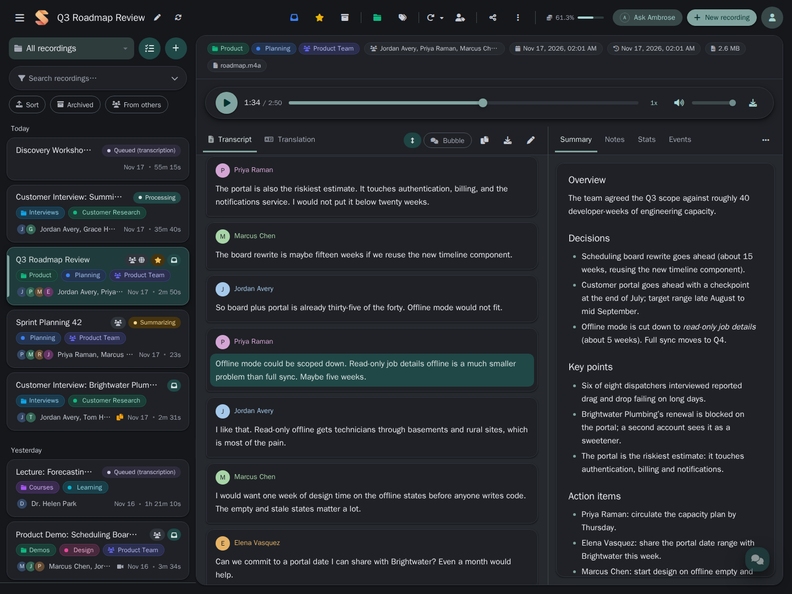
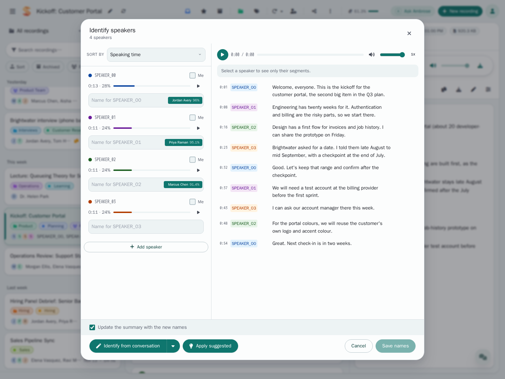
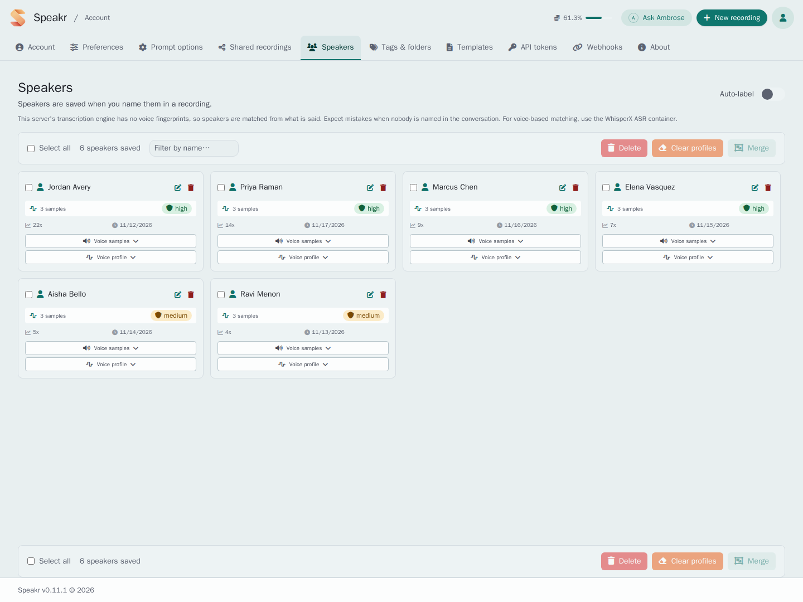
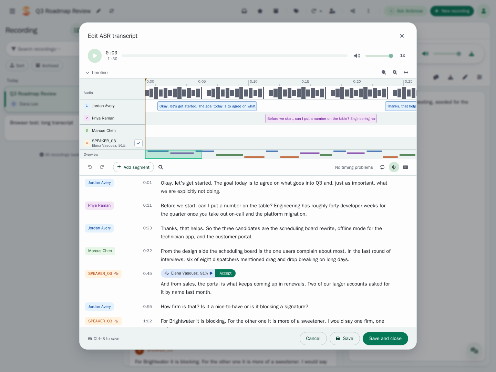
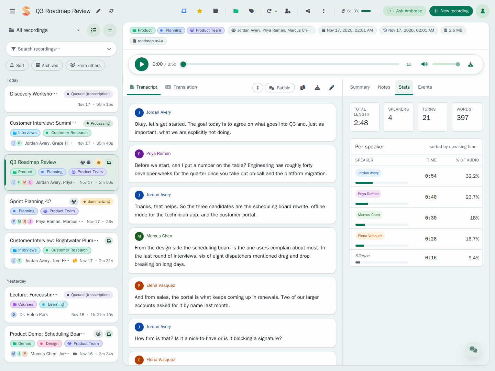
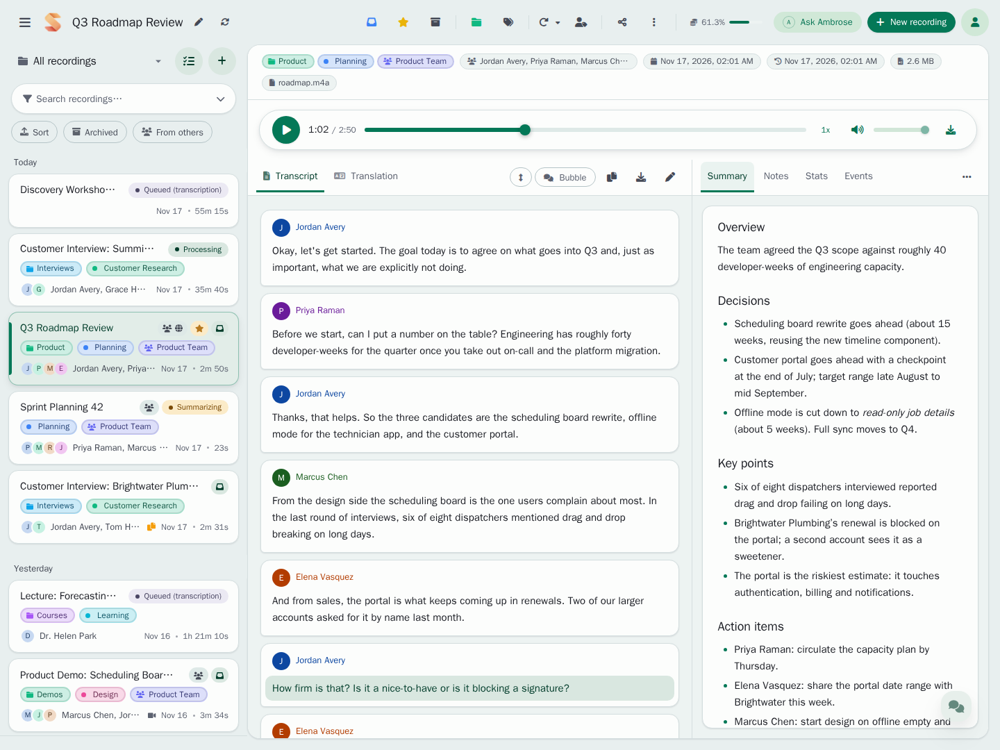
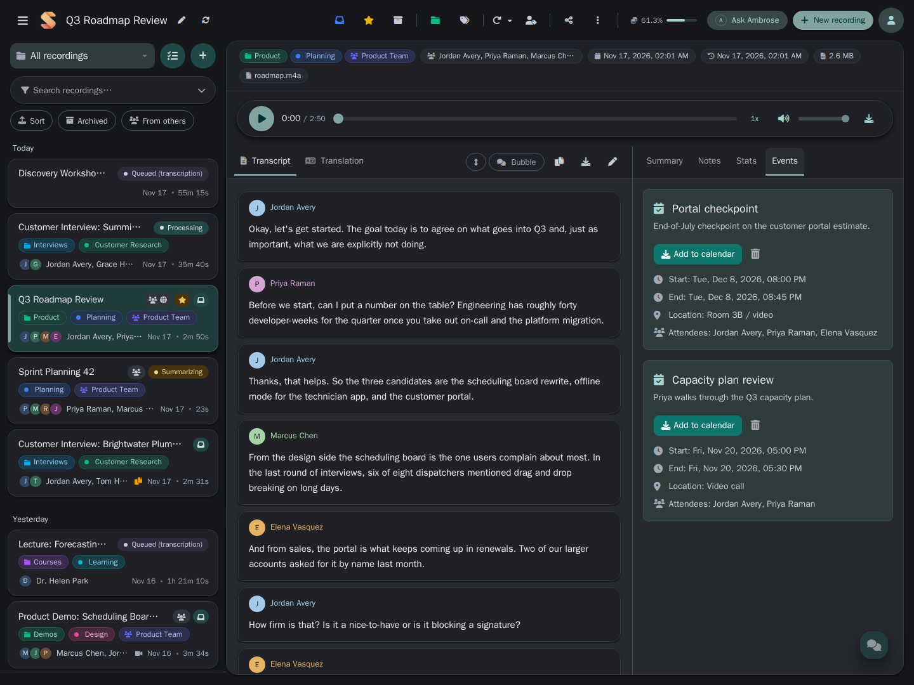
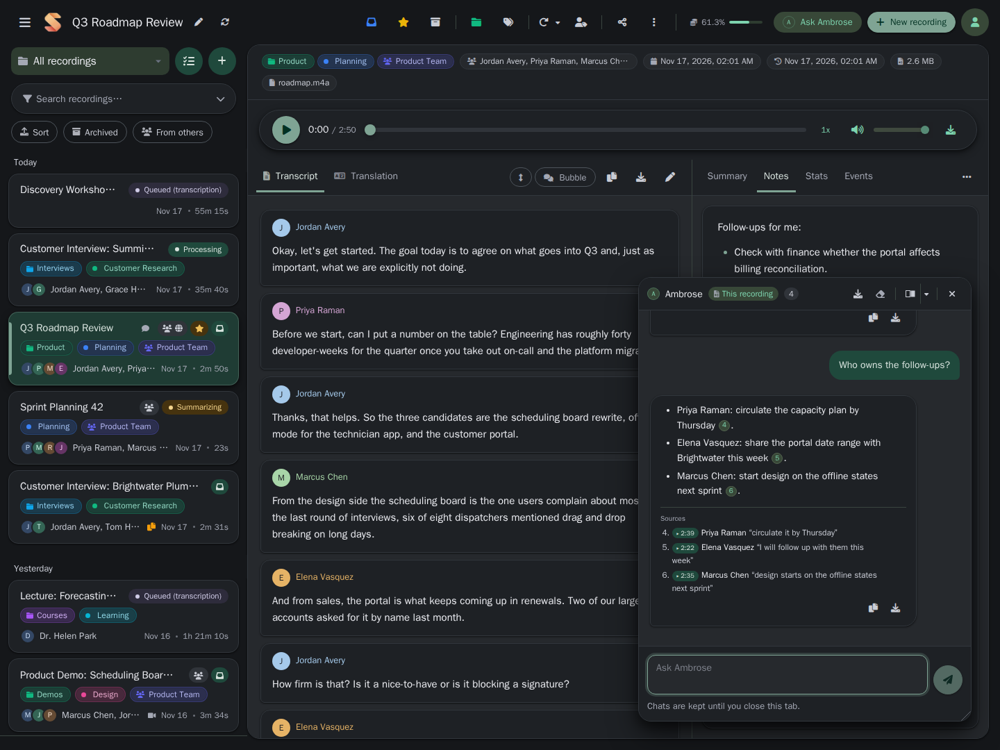
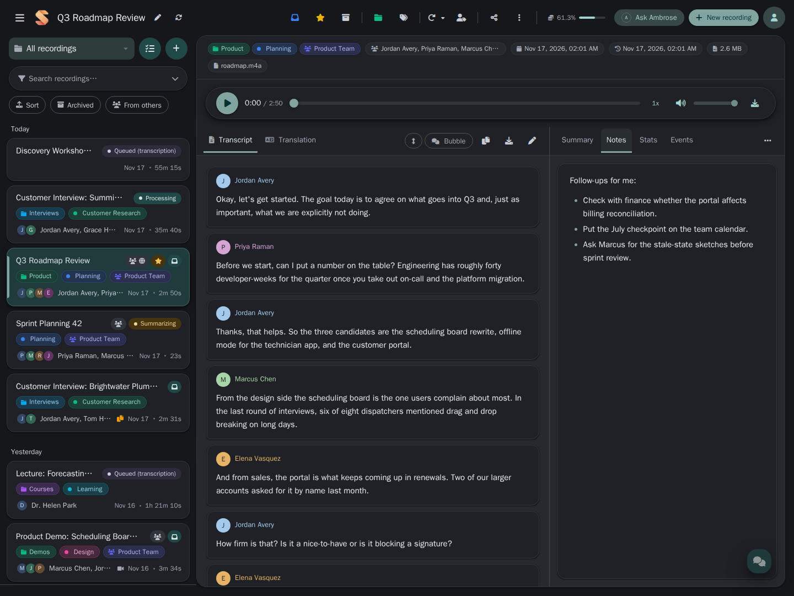

# Working with Transcriptions

Once your audio has been processed, Speakr provides a rich set of tools for viewing, editing, and interacting with your transcriptions. This section covers everything you need to know about working with transcribed content. For information on the transcription process itself, see [transcription features](../features.md#core-transcription-features).

## Understanding the Transcription View

When you select a recording from the sidebar, the center panel displays the full transcription. The layout is designed for easy reading and navigation, with clear visual indicators for different speakers and timestamps.

*Transcription view with real-time audio synchronization and active segment highlighting*

## Speaker Identification

If your recording was processed with [speaker diarization](../features.md#speaker-diarization) enabled, each speaker's contributions are labeled with colored tags like SPEAKER_01, SPEAKER_02, and so on. This requires the [ASR endpoint](../getting-started.md#option-b-custom-asr-endpoint-configuration). These labels are automatically generated during transcription and help you follow multi-person conversations.

A label such as `SPEAKER_01` is a placeholder for a voice that has not been named. It belongs to one recording: `SPEAKER_01` of one recording and `SPEAKER_01` of another are unrelated voices. A placeholder is therefore never saved as a speaker. No voice profile, voice sample or quote is kept for it, and it is not listed under the participants, in the **Speakers** filters or in the saved speakers of a name field. In the transcript, in the speaker statistics and in downloads, it is shown as before. The same applies to the other forms of a placeholder, such as `Speaker 1`, `Speaker A`, `spk_0`, `Unknown` and `Unknown Speaker`.

### Identifying Speakers

When you need to assign real names to speaker labels, click the speaker identification button in the toolbar. This opens a modal where you can:

*Speaker identification modal with AI-powered voice profile suggestions based on previous recordings*

The speaker identification modal shows each detected speaker with a sample of their dialogue to help you identify them. When you've identified speakers in previous recordings, Speakr's voice recognition system analyzes voice embeddings and provides intelligent suggestions with confidence scores. You can enter real names for each speaker, and these names will replace the generic labels throughout the transcription. The system remembers these assignments and builds voice profiles, making it easier and faster to identify the same speakers in subsequent recordings.

**Identify from conversation** works differently: names mentioned in the conversation, for example when people introduce or address each other, are found with the text model and filled in for review. By default, only the speakers that are still unnamed are named; with **Re-identify all from conversation** in its menu, every speaker is identified again. A text model is required and voice profiles are not used, so voice matches appear as suggestions whether or not you use it. Without a configured text model the button is disabled.

### Renaming Speakers

Speakers are renamed in two places:

- In the **speaker identification dialog**, you name each speaker of the recording, with the voice and conversation suggestions described above.
- In the [segment editor](#advanced-asr-segment-editing), you click a speaker chip and type or choose a name in the speaker picker. Check **All segments of …** to rename that speaker in the whole recording.

The same names and voice matches are saved from both places. There is no separate dialog for editing speakers.

### Managing Saved Speakers

All speakers you identify are automatically saved to your speaker database. You can manage these saved speakers through the dedicated [Speakers Management tab](settings.md#speakers-management-tab) in your [account settings](settings.md). Navigate to Account > Speakers Management to view all your saved speakers.

A speaker is saved when a name is given. When a placeholder such as `Speaker 1` or `SPEAKER_03` is typed as the name, the turns are shown under that text and the speaker still counts as unnamed: nothing is saved, and no error is shown. When a named speaker of a recording is given a placeholder again, the voice of that recording is removed from the voice profile of the person; the saved speaker stays. A saved speaker cannot be renamed to a placeholder under Speakers Management.

The Speakers Management interface displays all your saved speakers in a responsive grid layout. Each speaker card shows the speaker's name, usage statistics including how many times they've been identified, when they were last used in a recording, and when they were first added to your database. The interface includes internal scrolling to handle large numbers of speakers while keeping the header and action buttons always visible.

You can delete individual speakers by clicking the trash icon on their card, or use the "Delete all" button to clear your entire speaker database. This is useful for maintaining privacy or when you need to start fresh with a new set of speakers. The speaker count at the bottom keeps track of how many speakers you have saved.

The system uses these saved speakers to provide suggestions when you're identifying speakers in new recordings, making the identification process faster over time as you build up your speaker database.

## Editing Transcriptions

Speakr provides two different editing modes depending on the type of transcription you're working with.

### Simple Text Editing

For standard transcriptions without speaker diarization, click the Edit button in the toolbar to enter a simple text editor. Your edits are preserved even when you [regenerate summaries](../features.md#automatic-summarization) or use the chat feature. This allows you to make corrections to the entire transcription as a single text block. You can fix transcription errors, add punctuation, insert clarifications, and improve formatting. Your changes are saved when you click the Save button.

### Advanced ASR Segment Editing

For transcriptions processed with [ASR](../features.md#speaker-diarization) and speaker diarization, Speakr offers a powerful segment-based editor that preserves the structure and timing of your transcription. If you encounter issues with speaker identification, see [troubleshooting](../troubleshooting.md#speaker-identification-not-working).

The ASR editor shows your transcription the way the transcript reads: each segment has a speaker chip, a compact time and its text. Everything is edited in place, every change can be undone, and long recordings stay responsive because only the segments in view are drawn.

**Edit Text Content**: Click into the text of a segment and type. Press **Enter** to split the segment at the cursor; the time of the cut follows the share of the text before it, or the playhead when it lies inside the segment. Press **Backspace** at the very start of a segment to merge it into the previous one, which keeps the previous segment's speaker. **Esc** leaves the text field so that the single-key shortcuts below work.

**Change Speakers**: Click a speaker chip to open the speaker picker. It lists the speakers of this recording first, then your saved speakers (those whose voice matches come first), and accepts a new name typed into its field. Placeholders such as `SPEAKER_02` are listed among the speakers of the recording only, never among the saved speakers. Check **All segments of …** to rename a speaker in the whole recording in one step. With one or more segments selected, the keys **1** to **9** assign the recording's speakers in the order shown in the picker.

**Voice Match Suggestions**: When a speaker is still an unnamed label (such as `SPEAKER_00`) and its voice matches one of your saved speakers, the best match is offered on the speaker's first segment and in the picker, for example "Dana Lee, 87%". The lane header of that speaker in the timeline offers it as well. Click the suggestion to hear a few of that speaker's longest segments, and **Accept** to rename the speaker in the whole recording; the message that follows has **Undo** in it. When the diarization split one person into two labels and both match the same saved speaker, both are offered: after you accept one, the button of the other reads **Merge**, and it gives those segments the same speaker, so one speaker and one lane are left. The match is recorded when you save, exactly as in the speaker identification dialog.

**Select Segments**: Click beside the text of a segment to select it, Shift-click to select a range, and Ctrl-click (Cmd-click on a Mac) to add or remove single segments. The toolbar then offers **Set speaker**, **Merge** and **Delete** for the selection.

**Adjust Timestamps**: Click a segment's time to play from it; hover over it to see the exact start and end. With a segment selected, **[** and **]** set its start and end to the playhead, and **Alt+Left** and **Alt+Right** move the start by 0.1 seconds (with Shift, the end). A neighbor that touches the edge moves with it. To type exact times, open the segment's menu (the three dots) and choose **Edit times**, or press **T**. Segments stay in order of their start time.

**Playback**: **Space** plays and pauses while the cursor is not in a text field, **L** loops the selected segment, and **S** splits it at the playhead. The segment being played is highlighted; the crosshair button in the toolbar turns following it on and off.

**Timeline**: Above the transcript, the timeline shows the waveform of the audio and one lane per speaker, with every segment as a block in the color of its speaker chip. The bar at its foot is an overview of the whole recording; drag its window to scroll. Click the ruler to move the playhead, drag the waveform to scroll, scroll with the wheel, and zoom with Ctrl+wheel (Cmd on a Mac), a pinch, or the magnifier buttons. A click on a block selects its segment in the transcript and changes nothing, and a segment selected in the transcript is brought into view on the timeline; a double-click plays the segment.

- Drag an **edge** of a block to change the start or end. The edge of a neighbor that touches it moves with it; hold **Alt** to move one edge alone.
- Drag a **block** to move it in time, or up or down to another lane to give it that speaker. The speaker changes once the block is more than half a lane away from its own.
- Drag on **empty lane space** to add a segment there, then type its text.

While you drag, the edge snaps to the edges of other segments, to the playhead and to pauses in the audio; hold **Ctrl** (Cmd) to turn snapping off, and press **Esc** to cancel the drag. Each drag is one undo step. On a phone, scroll with the waveform or the overview and drag in a lane with one finger. The waveform is prepared the first time the editor of a recording opens, which takes a few seconds for a recording of several hours; the lanes work in the meantime. **Timeline** at the top left of it folds the timeline away, and the editor remembers that.

**Speakers in the Timeline**: A speaker can be renamed in the whole recording by clicking its name in the timeline. The speaker picker is then shown for all segments of that speaker, and a saved speaker, another speaker of the recording or a typed name can be chosen. When a choice labeled **Merge into …** is selected, the segments are given to a speaker the recording already has, and one speaker and one lane are left. The change can be reversed with **Undo** in the message that follows. A voice match beside the name is accepted with its own **Accept** or **Merge** button, as before.

A speaker can be added with **Add speaker** beside **Overview** at the foot of the lane names (a plus sign on a phone). The new speaker is named with the next label (`SPEAKER_04` after `SPEAKER_03`) and has an empty lane and, among the first nine speakers, a number key. Segments are given to it with the speaker picker, with its number key, or by dragging a block or empty space in its lane, and it can be renamed through its name. The label is a placeholder: until a name is given, no saved speaker is created for it. A speaker without segments is not saved, and it can be removed with the trash button in its lane; the removal can be undone.

**Problems**: The toolbar counts segments whose end is not after their start and segments that overlap the previous segment of the same speaker. Click the count to step through them.

**Undo and Redo**: **Ctrl+Z** undoes and **Ctrl+Shift+Z** or **Ctrl+Y** redoes (Cmd on a Mac), also with the toolbar buttons. A burst of typing is one step, and so are a rename of a speaker in the whole recording and a Replace all.

**Find and Replace**: Click the search icon in the toolbar of the segment editor (or in the header of the text editor), or press Ctrl+F (Cmd+F on a Mac), to open the find and replace bar. The number of matches is shown as you type. Enter moves to the next match and Shift+Enter to the previous one; **Replace** replaces the selected match, and **Replace all** replaces every match in the transcript text. **Aa** limits the search to the same capitals, and **ab** to whole words. Speaker names are not changed (use the speaker picker for those), and nothing is saved until you save the transcript, so Cancel discards the replacements. After correcting a name throughout, regenerate the summary to carry the correction into it.

**Manage Segments**: **Add segment** in the toolbar adds an empty segment after the selected one (or at the playhead). The segment menu also holds Split at cursor, Merge with previous, Merge with next, Set start or end to playhead, Add segment below and Delete segment, so everything is reachable on a phone without a keyboard. **Delete** removes the selected segments.

The keyboard button in the toolbar lists all shortcuts.

**Unsaved Changes**: Closing the editor with unsaved changes asks before discarding them. While you edit, your changes are also kept in this browser; if the page is closed or reloaded before you save, the editor offers to restore them the next time you open the same transcript.

The ASR editor maintains the JSON structure of your transcription, which is essential for features like speaker-based search, audio synchronization (clicking on text to jump to that point in the audio), and proper display in bubble view. When you save changes in the ASR editor, the system preserves all timing and speaker information while applying your corrections.

Your edits are saved to the database when you click "Save changes". The system maintains a record that the transcription has been manually edited, which is useful for quality control and audit purposes. Note that if you reprocess the transcription later with full transcription reprocessing, your manual edits will be overwritten. To preserve your edits while updating the summary, use summary-only reprocessing instead.

#### Editor Productivity Features

The ASR editor includes several quality-of-life features for working through long transcripts:

**Autosave**: When enabled in your account preferences (`Account → Preferences → Autosave editor`), edits are saved automatically two seconds after the last keystroke. The Save indicator briefly flashes "Saved" each time a save completes. Autosave is opt-in so users who prefer explicit control over save points can leave it off.

**Save Without Closing**: **Save** keeps the editor open after saving, useful when you want to commit progress mid-edit without losing your place; **Save and close** saves and closes it.

**Update the Summary**: Check **Update the summary with the new names** in the footer to have the summary regenerated after you save, as in the speaker identification dialog. It is off each time the editor opens, applies to **Save** and to **Save and close**, and does nothing when the editor has no changes of yours to save. Autosave never regenerates the summary; the next save you make yourself does, for the edits autosave stored. The checkbox is not shown for a translation or an incognito recording.

**Ctrl+S**: Pressing `Ctrl+S` (or `Cmd+S` on macOS) anywhere in the editor saves without closing. Equivalent to clicking the save-without-closing button.

**Scroll Memory**: The editor remembers your scroll position when you close it. Reopening the editor for the same recording returns you to where you were instead of jumping to the top.

**Double-Click to Edit**: Double-clicking any segment in the simple transcript view opens the ASR editor and scrolls directly to that segment. The target row is briefly highlighted so it stands out among the others.

## View Options

The transcription panel offers two display modes to suit different preferences:

### Simple View

The default simple view presents the transcription as flowing text with inline speaker labels. This format is ideal for reading through content quickly and copying text for use in other applications. The clean, document-like appearance makes it easy to focus on the content without visual distractions.

When the **Show timestamps in simple view** preference is on (`Account → Preferences → Transcript Display`), each segment is preceded by a compact `mm:ss` (or `h:mm:ss` for longer recordings) timestamp paired with the speaker label as a two-part pill. The leading segment displays "Start" instead of `00:00` to read as a label rather than a bare number. Double-clicking the pill or its row opens the ASR editor at that segment.

### Bubble View

The bubble view formats the transcription like a chat conversation, with each speaker's contributions in separate message bubbles. This format works particularly well for interviews, debates, or any recording with back-and-forth dialogue. The visual separation makes it easier to follow who said what in rapid exchanges.

### Sticky Speaker Pills

In both simple view and on mobile, consecutive segments from the same speaker are grouped into a **speaker run**, and the speaker's name + timestamp pill at the top of the run **pins to the top of the scroll area** for the entire run. As you scroll through a long monologue, the speaker pill stays visible until a different speaker takes over, so you always know who's talking even mid-paragraph. This eliminates the previous behaviour where the pill would scroll away with its first segment.

### Finding Text in a Long Transcript

A transcript of more than 300 segments is drawn only around the part you are reading, so that a recording of several hours stays fast. The browser's own search sees only that part. On the recording page of such a transcript, press **Ctrl+F** (Cmd+F on a Mac) to open a find bar above the transcript. The whole transcript is searched.

- The number of matches is shown as you type.
- **Enter** moves to the next match and **Shift+Enter** to the previous one. The transcript scrolls to each match.
- **Esc** or the x closes the bar.
- Press Ctrl+F again while the cursor is in the bar to reach the browser's own search.

The Identify speakers dialog and the [public share page](sharing.md#what-recipients-experience) draw a long transcript the same way and have the same find bar, also behind a search button.

On a phone, the find bar is opened with the search button of the bar pinned above the transcript, for a transcript of any length. The **Transcript** / **Translation** switch, copy and follow playback are in the same bar; see [Phone Layout](pwa.md#phone-layout).

On a shorter transcript, Ctrl+F opens the browser's search as usual, because the whole transcript is on the page. To replace text, use the find and replace bar of the [editor](#advanced-asr-segment-editing).

## Recording Stats

A **Stats** tab appears in the right-rail tab strip when the recording has speaker diarisation with per-segment timestamps. The tab shows:

- **Headline metrics** — Total length of the recording, number of distinct speakers, conversation turns (each speaker switch counts as a turn), and total word count
- **Per-speaker breakdown** — A table (desktop) or card stack (mobile) showing each speaker's speaking time, percentage of total audio, turn count, words, and words-per-minute (WPM, only when a meaningful sample is present). A slim proportion bar visualises each speaker's share.
- **Silence row** — Detected silence is shown as its own row / card with the same proportion bar and duration so you can see how much of the meeting was actually quiet.

On mobile the Stats tab lives in the bottom-nav More overflow (alongside Notes and Events). Same data, narrower layout — the table becomes a card stack with each speaker as its own card, and the 4-column headline grid becomes a 2-column grid.

## Audio Synchronization and Follow Mode

For recordings processed with [speaker diarization](../features.md#speaker-diarization), Speakr provides bidirectional synchronization between the audio player and transcript, creating an interactive reading experience.

### Click-to-Play Navigation

Click on any part of the transcript to jump directly to that moment in the audio. This works in both simple and bubble views, allowing you to quickly navigate to specific portions of the conversation you want to hear. Each transcript segment includes timestamp information that seamlessly syncs with the audio player.

### Active Segment Highlighting

As your audio plays, Speakr automatically highlights the currently spoken text in the transcript. The active segment is displayed with a prominent rounded box and subtle animation, making it effortless to follow along with the audio. This real-time highlighting works in both view modes:

- **Simple View**: The current speaker segment is highlighted with rounded corners and increased padding for clear visibility
- **Bubble View**: The active message bubble scales slightly and receives the same highlight treatment

### Auto-Scroll Follow Mode

Enable follow mode using the compact checkbox control in the transcript header (indicated by vertical arrows icon). When active, the transcript panel automatically scrolls to keep the currently playing segment centered in view. This is particularly useful for:

- Following along during long recordings without manual scrolling
- Reviewing specific sections while listening at different playback speeds
- Accessibility - keeping visual and audio content synchronized

Your follow mode preference is saved automatically and persists across sessions and different recordings. The feature intelligently resets when you switch between recordings, ensuring a clean slate for each playback session.

### Follow Mode in Action

The auto-scroll follow mode works seamlessly in both view modes and adapts to your theme preference. The highlighted segment uses rounded corners and subtle animations to draw your eye to the currently playing text without being distracting. The auto-scroll behavior is smooth and intelligent, maintaining the active segment in the center of your view for comfortable reading during long recordings.

## Using the Summary Feature

The Summary tab in the right panel contains an AI-generated overview of your recording. This summary is automatically created after transcription and captures key points, decisions, and action items.

The summary is designed to save you time by highlighting the most important information from your recording. It typically includes main topics discussed, key decisions or conclusions reached, action items and assignments, important dates or deadlines mentioned, and any significant problems or concerns raised.

### Customizing Summary Prompts

Speakr provides multiple levels of customization for summary generation, allowing you to tailor the AI's output to your specific needs. The summary prompt can be customized at three different levels:

**Admin Level**: System administrators can set a default summary prompt that applies to all users who haven't configured their own. This is configured in the Admin Dashboard under Default Prompts and serves as the baseline for the entire system.

**User Level**: Individual users can set their personal summary prompt in [Account Settings under Custom Prompts](settings.md#custom-prompts-tab). This overrides the admin default and applies to all of their recordings unless a tag-specific prompt is used.

**Tag Level**: Each tag can have its own custom prompt configured. When creating or editing a tag, you can specify a summary prompt that will be used for any recording with that tag. This is particularly powerful for different types of content - for example, a "Legal Meeting" tag might focus on compliance issues and risk factors, while a "Product Planning" tag might emphasize features and timelines.

### Prompt Precedence and Stacking

When generating a summary, Speakr follows a clear precedence order to determine which prompt to use:

1. **Tag Custom Prompts** (highest priority): If a recording has tags with custom prompts, these take precedence. When multiple tags with custom prompts are applied to a recording, Speakr intelligently combines them in the order the tags were added. This creates a sophisticated stacking effect where you can have a base tag like "Meeting" with general instructions, then add modifier tags like "Client-Facing" or "Technical Discussion" that add specific requirements. The prompts are seamlessly merged to create comprehensive instructions for the AI.

2. **User Summary Prompt**: If no tag prompts are present, the system uses your personal summary prompt configured in your account settings.

3. **Admin Default Prompt**: When neither tag nor user prompts are configured, the system falls back to the administrator-configured default prompt.

4. **System Fallback**: If no custom prompts exist at any level, Speakr uses a built-in default that generates sections for key issues, decisions, and action items.

### Summary Quality Factors

The quality of your generated summaries depends on two key factors:

**Prompt Design**: Well-crafted prompts that clearly specify what information you want extracted will produce more useful summaries. Consider including specific sections you want, the level of detail needed, and any particular focus areas relevant to your use case.

**LLM Selection**: The AI model you use significantly impacts summary quality. More advanced models like GPT-4 or Claude will generally produce more nuanced and accurate summaries compared to smaller models. The model can be configured by your administrator in the system settings, balancing between quality and cost.

### Editing and Exporting Summaries

The summary is fully editable using a markdown editor similar to the one in the Notes section. Click the edit button (pencil icon) in the summary toolbar to enter edit mode. The markdown editor provides a rich editing experience with formatting tools for bold, italic, headings, lists, links, and more. You can restructure the summary, add additional insights, or refine the AI-generated content to better suit your needs. Changes are auto-saved as you type, ensuring you don't lose your edits.

You can export the summary in multiple ways. The copy button copies the entire summary to your clipboard in markdown format, ready to paste into emails, documents, or other applications. The download button offers two formats. **Word document (.docx)** keeps the formatting and suits colleagues who work in Word. **Markdown (.md)** saves the summary text as written, under a heading with the recording title, and links to recordings in it point to your Speakr address. Both files are named after the recording title, such as `summary-Weekly-Sync.docx` or `summary-Weekly Sync.md`.

### Regenerating a Summary

The **Regenerate summary** dialog runs the summary again with a prompt you can see and change. Open it from **Reprocess summary** in the recording's reprocess menu, or from the slider icon in the summary toolbar. On a recording without a summary, the slider icon next to **Generate summary** opens the same dialog, and the run generates the first summary. You need edit access to the recording.

The dialog shows the prompt that applies to you for this recording, in an editable text box. A chip beside the **Prompt** label names where it comes from:

- **From tag: X**: a tag on the recording that carries a summary prompt. When several of your tags carry prompts, their prompts are joined in the order the tags were added.
- **From folder: X**: the recording's folder. Folder prompts apply only when you own the recording.
- **Your default**: the summary prompt in your account settings.
- **Admin default**: the default your administrator set.
- **Built-in default**: the prompt Speakr ships with.

Everyone sees only their own prompt. When you edit a recording someone shared with you, the dialog shows your tags and your default prompt, never the owner's, and the prompt you see is the one that runs. Summaries made automatically after upload or transcription still use the owner's prompt.

**Start from** fills the text box from another prompt. It lists the prompts that apply to this recording first, then your other prompts: your default, the admin default and your tags with summary prompts. **Blank** empties the box so you can write a prompt from scratch.

Once you change the prompt, the chip reads **Edited from …** and two links appear. **Reset** puts the original prompt back. **Save to …** writes your edited prompt back to where it came from: your own tag, a folder you own, or your default. Nothing is saved unless you click it, and the dialog never offers to save to the admin default or to a tag or folder you can't edit. An edited prompt runs in place of the original for this regeneration only.

**Add instructions (optional)** takes one-off context, such as a meeting agenda or a focus for this run. The instructions are added after the prompt for this run only and are not saved.

If the prompt uses `{{name}}` placeholders, a **Prompt variables** row shows how many have values. Expand it to edit them. The values you supplied at upload are filled in, and your changes are stored on the recording, so later regenerations and exports use them. See the [Prompt Variables guide](settings.md#prompt-variables) for the full feature.

Regenerating replaces the current summary, including any edits you made to it. Your transcription is not changed, so you can try different prompts without any risk to the transcript. If you use the same one-off prompt often, save it to a tag so it is one click away in **Start from**.

## Event Extraction

When event extraction is enabled in your account settings, calendar-worthy events in each recording are identified after it is processed. Events are extracted whether or not a summary is generated: with automatic summarization turned off, they are found in the transcript itself. This feature intelligently detects meetings, deadlines, appointments, and other time-sensitive items mentioned in your conversations.

### Viewing Extracted Events

After a recording is processed with event extraction enabled, an Events tab appears in the right panel if any events were detected. The tab shows a clean list of identified events, each displaying the event title, date, time, and description extracted from the conversation. Events are automatically parsed with intelligent date recognition that understands relative references like "next Tuesday" or "in two weeks" based on the recording date, counted in your timezone (Account → Preferences).

### Exporting to Calendar

Each extracted event can be exported as an ICS file that's compatible with virtually any calendar application including Google Calendar, Outlook, Apple Calendar, and Thunderbird. Simply click the download button next to any event to save it as a calendar file. The ICS file includes the event title, date and time, and a description with context from the recording. When no specific time is mentioned in the conversation, events default to 9 AM to ensure they appear prominently in your calendar.

### Enabling Event Extraction

Event extraction can be toggled on or off in your Account Settings under the Custom Prompts tab. When it is enabled, the AI is asked in a separate request to identify calendar-worthy items, with the summary when there is one and the transcript otherwise. This feature works with any LLM provider configured in your system and adapts to different conversation styles, from formal meetings to casual discussions. The quality of event extraction depends on the AI model being used, with more advanced models providing better detection of nuanced scheduling references.

## Ask Ambrose about a recording

Ambrose is Speakr's assistant (formerly "Chat with Transcription"). Open the assistant panel with the round button at the bottom right of a recording, or with the Ambrose tab on a phone. The panel header shows Ambrose's monogram, the name and a scope chip reading **This recording**: Ambrose answers from this recording's full transcript and can point you to the moment something was said. Type a question in the box marked "Ask Ambrose" and press Enter to send it; for a new line, press Ctrl+Enter (the hint is also on the send button).

Ambrose is the default name. You can give the assistant another name under Account → Preferences → **Assistant** (see [Settings](settings.md#assistant)). To ask about many recordings at once, use the [Ask Ambrose](inquire-mode.md) page.

Each recording keeps its own chat until you close the browser tab, and answers cite the transcript with numbers you can click to play that moment. See [Ambrose](ambrose.md) for chats per recording, incognito recordings, citations and searches of your library.

### Effective questions

Ambrose can answer many kinds of questions about the recording. You can ask for specific information like "What did Sarah say about the budget?" or "When is the deadline for the project?" Ambrose can also analyze, for example "What were the main concerns raised?" or "Summarize the action items for the marketing group."

Ambrose keeps the earlier questions in mind, so you can ask follow-up questions. For example, after asking about budget discussions, you might follow up with "What solutions were proposed?" Ambrose takes it as a question about the budget.

### Good practice

Answers are best when questions are specific, not overly broad. Reference specific topics, people, or timeframes when possible. If an answer misses the point, rephrase the question with more context.

Ambrose is most reliable on factual questions about what was said in the recording, and less reliable on subjective interpretation, though it can describe tone and sentiment to some degree.

### Exporting a conversation

A conversation has three export options:

**Copy a response**: The copy button on a response copies that response to your clipboard as markdown.

**Download the chat**: The download button in the panel header saves the whole conversation as a Microsoft Word (.docx) file named after the recording, such as `chat-Weekly-Sync.docx`.

**Download one response**: Each response has a download button beside its copy button. With it, that response and the question before it are saved as a Word file, such as `chat-Weekly-Sync-response.docx`. Model reasoning is included when the response has it, as in the chat download.

These exports are useful when you have used Ambrose to extract specific insights or conduct a detailed analysis of the recording, allowing you to preserve and share your findings without having to recreate the conversation.

## Adding and Managing Notes

The Notes tab is your personal workspace for adding context and thoughts about the recording. These notes are **always private** - only you can see them, whether you own the recording or it's been shared with you. This is different from summaries, which are shared with all users who have access to the recording.

**Important: Notes are Personal, Summaries are Shared**

- **Notes**: Always private to each user. You can add and edit your own notes on any recording (owned or shared) without needing any special permissions. Other users cannot see your notes, and you cannot see theirs.
- **Summary**: Shared content created by the recording owner. Only users with edit permission can modify the summary, and all users with access to the recording see the same summary.

Notes support full markdown formatting, allowing you to create structured documents with headers, lists, links, and emphasis. The markdown editor provides a toolbar with formatting options and supports keyboard shortcuts for efficient note-taking. You can switch between edit and preview modes to see how your formatted notes will appear.

Common uses for notes include:

- Personal reflections on the meeting or conversation that you want to keep private
- Follow-up tasks that you need to complete based on the discussion
- Additional context about decisions made or why certain topics were discussed
- Links to related documents or resources mentioned in the recording
- Questions you want to research or clarify later

Your notes are fully searchable alongside transcriptions, making them valuable for future reference. You can search for a specific term and find it whether it appears in a transcription or in your personal notes. The search will only find results in your own personal notes - you cannot search through other users' notes on shared recordings since notes are always private. Notes are auto-saved as you type, ensuring you never lose your thoughts.

When viewing a shared recording, you can always add and edit your own notes without needing any special permissions. This allows you to annotate shared content with your own thoughts, action items, and follow-ups while keeping them completely private from the recording owner and other users.

## Copying and Exporting

The Copy button in the transcription toolbar copies the entire transcription to your clipboard in plain text format. This maintains paragraph structure, making it easy to paste into documents or emails.

### Downloading Transcriptions

Next to the Copy button, you'll find the Download button that offers flexible export options through customizable templates. When you click Download, a popup appears allowing you to select from your saved [transcript templates](transcript-templates.md) or export the raw transcript without formatting. Templates let you control exactly how your transcript is formatted, whether you need timestamps for subtitles, speaker-focused formats for interviews, or screenplay-style formatting. You can create and manage these templates in your account settings.

If your recording was processed with ASR and speaker diarization, the exported text will include speaker identifiers (either the generic labels like SPEAKER_01 or the actual names if you've identified them). For recordings without speaker diarization, the transcription is exported as continuous text. The format remains consistent regardless of whether you're viewing the transcription in simple or bubble view - the exported text uses the structured format from the underlying data, formatted according to your chosen template.

### Printing a Transcript

Use the print command of your browser (**Ctrl+P**, or Cmd+P on a Mac) on the recording page. A transcript of more than 300 segments is printed in full, not only the part on the screen: the title of the recording, then the text under a heading for each speaker. Timestamps are not printed. A shorter transcript is printed as the page shows it.

For a document with timestamps or your own layout, download the transcript with a [template](transcript-templates.md).

## Next Steps

Next, the Ask Ambrose page: questions across all your recordings at once.

---

Next: [Ask Ambrose](inquire-mode.md) →